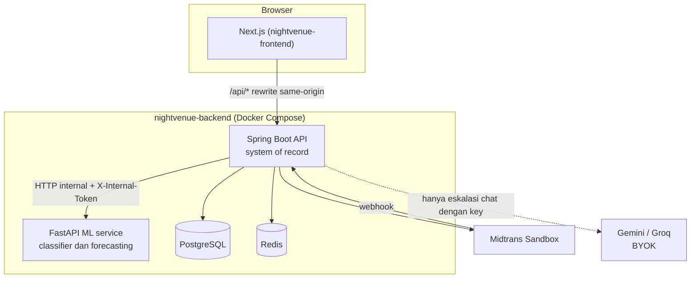
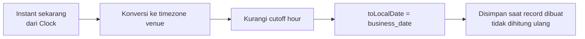
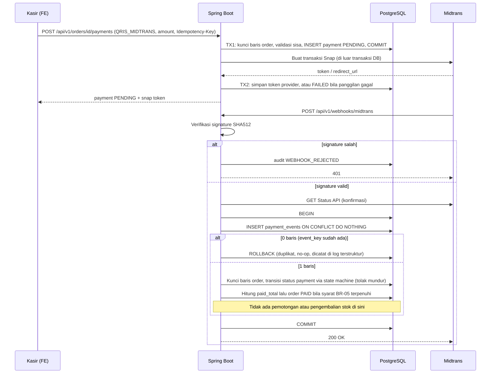
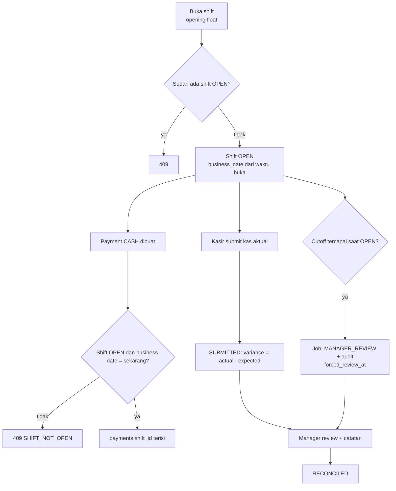
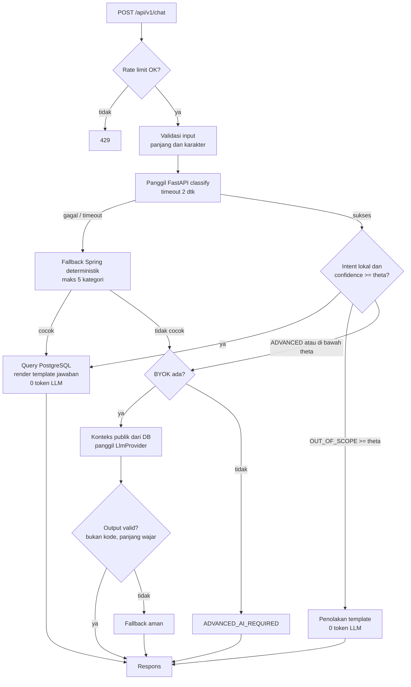

# APPLICATION_ARCHITECTURE — NightVenue

Pemilik: Backend (Claude + Qwen). Disetujui: PM (GPT). Pendamping: `PRD.md`, `DECISIONS.md` (seluruh ADR), `DATABASE.md`, `UML.md`.

---

## 1. Gambaran Sistem



| Komponen | Boleh | Tidak boleh |
|---|---|---|
| Spring Boot | Semua logika bisnis, auth, uang, stok, status, BusinessDateService, routing chat | — |
| FastAPI | Klasifikasi intent; prediksi stok dari deret numerik | Akses DB, auth, checkout, payment, mutasi inventory/bottle, aturan transaksional |
| PostgreSQL | Sumber kebenaran | — |
| Redis | Cache menu, rate limit, refresh token | State bisnis utama |
| Frontend | Presentasi, validasi UX | Menjadi batas keamanan |

**Kegagalan FastAPI tidak menghentikan transaksi inti**: order, payment, void, bottle, dan shift tidak memanggil FastAPI. Hanya chat dan forecasting yang bergantung padanya, dan chat memiliki fallback (bagian 7.6).

---

## 2. Stack

Versi dipin di Phase 1 (ADR-018) dan dicatat di `CONTEXT.md`. Yang dikunci adalah keluarga teknologi.

| Lapisan | Teknologi |
|---|---|
| Frontend | Next.js (App Router), TypeScript strict, Tailwind, shadcn/ui, TanStack Query, Zustand, React Hook Form + Zod, Midtrans Snap.js |
| Backend | Java LTS, Spring Boot, Spring Security, Spring Data JPA/Hibernate, Flyway, MapStruct, springdoc-openapi, Actuator, rate limit via Redis |
| ML | Python, FastAPI, scikit-learn, pandas, joblib |
| Data | PostgreSQL, Redis |
| Test | JUnit 5, Mockito, Testcontainers, Vitest, RTL, pytest, k6 |
| CI/CD | GitHub Actions, GHCR, Vercel |

---

## 3. Struktur Repository

```text
nightvenue-backend/
├── api/src/main/java/com/nightvenue/api/
│   ├── common/        error, idempotency, security util, audit, Clock
│   ├── businessday/   BusinessDateService
│   ├── auth/
│   ├── venue/
│   ├── catalog/       product, category, ingredient, recipe
│   ├── inventory/     inventory, ledger, adjustment
│   ├── pos/           table, order, order item, void
│   ├── payment/       payment, PaymentGateway, webhook
│   ├── bottle/        vault, redeem, expiry job
│   ├── shift/         cashier shift, cutoff job
│   ├── forecast/      client ke ml-service
│   └── chat/          ChatRouter, fallback, LlmProvider, logging metrik
│   └── (resources)/db/migration/   Flyway V*__*.sql
├── ml-service/        app/, data/ (train, val, test), reports/, models/
├── infra/
├── docker-compose.yml
├── .github/workflows/{ci-api,ci-ml,docker}.yml
└── CONTEXT.md  README.md  .env.example  (+ salinan docs)

nightvenue-frontend/
├── src/app/           (staff)/pos, (staff)/inventory, (staff)/shift, (staff)/bottles, (customer)/..., demo chat
├── src/features/  components/  hooks/  lib/  services/  stores/
├── src/types/api.ts   DIGENERATE dari OpenAPI, jangan diedit manual
└── .github/workflows/ci.yml  CONTEXT.md  README.md  .env.example
```

Dua repo saja (ADR-008). Paket untuk fitur deferred (reservation, loyalty, transfer, report, recovery) **tidak dibuat**.

---

## 4. Layering Backend

```text
Controller → Service (@Transactional, aturan bisnis) → Repository
DTO in/out (validasi)        MapStruct                  JPA / JdbcTemplate (query atomic)
```

1. Entity tidak keluar dari controller; selalu DTO.
2. `@Transactional` hanya di service; batas transaksi = satu use case.
3. Query atomic stok dan vault ditulis eksplisit (`@Modifying`), bukan load-modify-save.
4. Otorisasi dua lapis: `@PreAuthorize` (role) dan pengecekan venue di service.
5. Panggilan HTTP eksternal (Midtrans, ML, LLM) **tidak boleh** di dalam transaksi yang memegang lock.
6. Waktu hanya dari `Clock` yang diinjeksi; business date hanya dari `BusinessDateService` (ADR-001).
7. Controller chat, order, dan payment tidak saling memanggil lewat HTTP internal.
8. Urutan lock tetap: baris `orders` → `payments` → `inventory_items` (ID menaik). Jangan dibalik; add-item, payment, webhook, dan VOID semuanya mengikuti urutan ini.

---

## 5. Konvensi API

| Hal | Aturan |
|---|---|
| Prefix | `/api/v1/*` (perubahan breaking → `/api/v2`). Actuator tidak diberi prefix |
| Format error | RFC 7807 `application/problem+json` (`type`, `title`, `status`, `detail`, `traceId`, `errors[]`) |
| Idempotency | `Idempotency-Key` (UUID) wajib pada: tambah item order, buat payment, VOID, deposit botol, redeem botol. Unique `(scope, user, key)`; request ulang → respons sama |
| Paginasi | `page`, `size` (maks 100) |
| Correlation | `X-Request-Id` masuk MDC dan respons |
| Status | 400 validasi, 401, 403 role, 404 tidak ada / di luar venue, 409 konflik (stok, state, duplikat, shift), 422 aturan bisnis, 429 rate limit |
| Kontrak | OpenAPI dari springdoc; tipe FE digenerate; CI FE gagal bila berubah tanpa pembaruan |

**Permukaan API (indikatif, kontrak final = OpenAPI).** Semua path aplikasi diawali `/api/v1`; FastAPI internal memakai `/ml/*`.

| Area | Endpoint |
|---|---|
| Auth | `POST /api/v1/auth/login`, `/api/v1/auth/refresh`, `/api/v1/auth/logout` |
| Katalog / inventory | `/api/v1/products`, `/api/v1/ingredients`, `/api/v1/recipes`, `/api/v1/inventory`, `POST /api/v1/inventory/{id}/adjust`, `/api/v1/tables` |
| Order | `POST /api/v1/orders`, `GET /api/v1/orders/{id}`, `POST /api/v1/orders/{id}/items`, `POST /api/v1/orders/{id}/items/{itemId}/serve`, `POST /api/v1/orders/{id}/void` |
| Payment | `POST /api/v1/orders/{id}/payments`, `POST /api/v1/webhooks/midtrans` (publik, tanpa JWT) |
| Bottle | `POST /api/v1/bottles` (deposit, `Idempotency-Key`), `POST /api/v1/bottles/redeem`, `GET /api/v1/bottles`, `GET /api/v1/customers/me/bottles` |
| Shift | `POST /api/v1/shifts/open`, `POST /api/v1/shifts/{id}/submit`, `POST /api/v1/shifts/{id}/review`, `GET /api/v1/shifts` |
| Forecast | `POST /api/v1/forecasts`, `GET /api/v1/forecasts` |
| Chat | `POST /api/v1/chat` (anonim diperbolehkan, rate-limited) |
| FastAPI (internal) | `POST /ml/chat/classify`, `POST /ml/forecast/inventory`, `GET /health` |

---

## 6. Keamanan

| Topik | Rancangan |
|---|---|
| Password | BCrypt |
| Access token | JWT pendek (mis. 15 menit), disimpan di memori FE |
| Refresh token | Acak panjang, **hash**-nya di Redis dengan rotasi; reuse → cabut semua sesi. Cookie `httpOnly; Secure; SameSite=Lax` (ADR-009) |
| Same-origin | Browser hanya memanggil origin FE; Next.js `rewrites` meneruskan `/api/*` |
| CORS | Whitelist eksplisit |
| Webhook Midtrans | Endpoint publik; keamanan dari signature + Status API; idempotensi dari `payment_events` (ADR-006) |
| Rate limit | Redis token bucket per IP (dan user bila login): `/auth/*`, checkout, `/chat` (10 req/menit/IP sebagai baseline). `X-Forwarded-For` hanya dari proxy tepercaya |
| BYOK | Key di header `X-AI-Key`, hanya untuk request itu; **transit melalui server**; tidak disimpan, tidak dicatat, tidak masuk telemetry error (ADR-013) |
| Secret | Hanya env; `.env.example` tanpa nilai nyata; gitleaks di CI |
| Log | Dilarang mencatat password, token, `X-AI-Key`, isi `/chat`; header sensitif difilter |
| Internal ML | Hanya jaringan Docker, `X-Internal-Token`, port tidak dipublikasikan |
| PII | Tidak menyimpan nomor identitas; chat tidak dipersistensi |

---

## 7. Alur Kritis

### 7.1 Business Date



Hanya `BusinessDateService` yang melakukan ini. Contoh dan tabel batas ada di ADR-001.

### 7.2 Tambah item ke order (Stock-at-Order)

Satu transaksi DB:

```text
1. Validasi order OPEN/PARTIALLY_PAID dan venue user; cek Idempotency-Key
2. Kunci baris order: SELECT ... FROM orders WHERE id = :id FOR UPDATE
   (menserialkan add-item, payment, dan VOID pada order yang sama)
3. Produk is_bottle_keepable: quantity harus 1, selain itu 422 (BR-29)
4. INSERT order_items (snapshot nama dan harga, status ORDERED) -> dapat order_item_id
5. Ambil recipe tiap item; bentuk pasangan (item, ingredient, kebutuhan)
   dan urutkan menurut ingredient_id ASC
6. Untuk tiap pasangan pada lokasi BAR venue:
     UPDATE inventory_items
        SET quantity = quantity - :need, version = version + 1
      WHERE location_id = :bar AND ingredient_id = :ing AND quantity >= :need;
     rows = 0 -> rollback seluruhnya (order_item dari langkah 4 ikut batal),
                 409 INSUFFICIENT_STOCK (sebut bahan)
     rows = 1 -> INSERT inventory_transactions
                 (SALE_DEDUCT, delta, balance_after, business_date,
                  reference_type ORDER_ITEM, reference_id = order_item_id)
7. Hitung ulang subtotal/service/pajak/total_due
```

Mengapa bukan optimistic lock: bahan populer adalah baris panas; konflik versi memicu retry berantai. Conditional UPDATE menjadikan database penjaga invarian; urutan ID mencegah deadlock (ADR-003).

### 7.3 Pembayaran dan webhook

**Invarian konkurensi (ADR-005, BR-28):** pembuatan payment diserialkan terhadap baris order. Di dalam transaksi pembuatan: `SELECT ... FROM orders WHERE id = :id FOR UPDATE`, hitung `sisa = total_due − SUM(PAID) − SUM(PENDING)`, tolak 422 bila `amount > sisa`, lalu INSERT payment. Payment `PENDING` ikut menahan sisa, sehingga dua request berbeda `Idempotency-Key` tidak dapat melampaui tagihan. `Idempotency-Key` hanya melindungi request yang sama, bukan masalah ini.

**CASH / CARD_EDC:** satu transaksi (lock order, validasi sisa, INSERT payment `PAID`, hitung penutupan order). **Setiap payment CASH wajib teratribusi ke shift `OPEN` milik pemrosesnya, apa pun rolenya** (Manager/Admin yang menerima tunai membuka shift sendiri, lihat 7.6); tanpa itu 409 `SHIFT_NOT_OPEN`.

**QRIS (tiga langkah; panggilan eksternal di luar lock):**
1. TX1: lock order, validasi sisa, INSERT payment `PENDING` (menahan sisa), commit.
2. Panggil Midtrans (tanpa transaksi dan tanpa lock).
3. TX2: simpan token/redirect dan `provider_transaction_id`. Bila panggilan gagal, payment diubah `FAILED` sehingga sisa dilepas.

Pemulihan: bila proses mati antara langkah 1 dan 3, payment tertinggal `PENDING` tanpa referensi provider. Job penyapu mengubahnya menjadi `EXPIRED` setelah batas waktu konfigurasi (sisa dilepas). Payment yang sudah punya referensi provider diselesaikan oleh webhook dan Status API.



Duplikat dideteksi lewat `INSERT ... ON CONFLICT DO NOTHING` (0 baris), bukan dengan menangkap exception di transaksi utama, karena di PostgreSQL pelanggaran unique membatalkan transaksi. Pengiriman duplikat tidak menambah baris `payment_events`; buktinya log terstruktur (`event_key`, `payment_id`).

Bila order sudah `VOIDED` saat settlement tiba: payment dicatat `PAID`, order tetap `VOIDED`, `audit_logs` menerima `PAYMENT_ON_CLOSED_ORDER` (BR-21).

### 7.4 VOID (kompensasi)

Satu transaksi:

```text
1. Cek Idempotency-Key dan otorisasi (ambang manager, disposition WASTED hanya Manager/Admin)
2. Tolak 409 bila order punya payment PENDING atau PAID
3. UPDATE orders SET status = 'VOIDED' WHERE id = :id AND status = 'OPEN'
     rows = 0 -> 409 (sudah void / state salah); selesai tanpa menyentuh stok
4. Untuk tiap item aktif (ORDERED/SERVED):
     disposition = RESTORED hanya bila item ORDERED dan diminta RESTORED; selain itu WASTED
     INSERT void_logs (UQ order_item_id menjamin sekali)
     UPDATE order_items SET status = 'VOIDED'
     bila RESTORED: untuk tiap baris SALE_DEDUCT milik item (urut inventory_item_id ASC):
         UPDATE inventory_items SET quantity = quantity + :delta_asli
         INSERT inventory_transactions (VOID_RETURN, reference VOID_LOG, business_date)
5. INSERT audit_logs ORDER_VOID
```

Pengembalian dibaca dari ledger, bukan dari recipe saat ini (ADR-004).

### 7.5 Bottle: deposit dan redeem

Deposit (`Idempotency-Key`; item produk `is_bottle_keepable` dengan `quantity = 1` pada order `PAID`, customer `age_verified`, item belum punya vault karena `source_order_item_id` UNIQUE, BR-29): buat vault `ACTIVE`, buat token acak 128-bit, simpan hash SHA-256, kembalikan token mentah **sekali**, tulis `DEPOSIT`.

Redeem (`Idempotency-Key`; body: `qrToken`, `orderId`, `volumeMl`, `ownerConfirmed`):

```text
1. Cari vault dari hash(qrToken); order.customer_id harus = vault.customer_id; ownerConfirmed = true
2. Tambah order_item BOTTLE_REDEMPTION (harga 0 atau biaya layanan; tanpa pemotongan inventory)
3. UPDATE bottle_vaults
      SET remaining_volume_ml = remaining_volume_ml - :ml,
          status = CASE WHEN remaining_volume_ml - :ml = 0 THEN 'EMPTY' ELSE status END,
          version = version + 1
    WHERE id = :id AND status = 'ACTIVE'
      AND expiry_date >= :businessDate AND remaining_volume_ml >= :ml;
   rows = 0 -> 409 (habis / kedaluwarsa / tidak aktif), rollback
4. INSERT bottle_vault_transactions (REDEEM, -ml, remaining_after, owner_confirmed, performed_by)
```
Ini bukan autentikasi kuat (ADR-020).

### 7.6 Shift dan cutoff



`expected_cash = opening_float + SUM(amount) payment CASH PAID dengan shift_id` (BR-23). Pengecekan di jalur request adalah penjaga utama; job hanya membalik status (ADR-002). Semua role yang menerima CASH memakai shift miliknya sendiri, dan reviewer tidak boleh pemilik shift yang direview (BR-30).

### 7.7 Hybrid chat



Setiap request menulis `chat_route_logs` (rute, intent, confidence, latensi, token, estimasi biaya) tanpa isi pesan dan tanpa key.

**Pemetaan intent → sumber jawaban lokal**

| Intent | Sumber | Catatan |
|---|---|---|
| OPENING_HOURS | `venues.opening_hours` | |
| VENUE_AREA | `venue_tables.area` (distinct + jumlah meja) | |
| MENU_INFORMATION | `products` aktif per kategori | |
| BOTTLE_KEEPING | `venue_faqs` (kebijakan) | |
| MINIMUM_SPEND | `venue_tables.minimum_spend` per area | |
| PROMOTION | `promotions` aktif pada business date sekarang | |
| TABLE_AVAILABILITY | `venue_tables.status = AVAILABLE` saat ini | Bukan ketersediaan tanggal mendatang (reservasi deferred) |
| RESERVATION | `venue_faqs` | Menyatakan reservasi belum tersedia di versi ini |
| GENERAL_VENUE_INFORMATION | `venues.address` + `venue_faqs` | |
| ADVANCED_CONVERSATION | Eskalasi LLM | |
| OUT_OF_SCOPE | Penolakan template | |

**Fallback Spring (maksimal lima)**: jam buka, alamat venue, minimum spend, area venue, kebijakan bottle keeping; regex/keyword.

**Kontrak ML**

```json
// POST /ml/chat/classify
{ "message": "kalau jam 2 pagi masih buka?" }
// response
{ "intent": "OPENING_HOURS", "confidence": 0.91, "requiresLlm": false, "modelVersion": "..." }

// POST /ml/forecast/inventory
{ "ingredientId": 12, "unit": "ML",
  "series": [ { "businessDate": "2026-08-01", "quantity": 1840.0 } ] }
// response
{ "ingredientId": 12, "unit": "ML", "horizonDays": 30, "predictedQuantity": 4200.0,
  "model": "weekday_linear", "modelMae": 0.0, "baselineMae": 0.0, "inputDays": 90 }
```
Angka pada contoh adalah tempat pengisi format, bukan hasil. `series` berasal dari ledger per `business_date`: `net_consumption = -(SUM(delta WHERE type IN ('SALE_DEDUCT','VOID_RETURN')))`. Contoh: SALE_DEDUCT −10 dan VOID_RETURN +4 menghasilkan konsumsi bersih 6 (bukan 14).

### 7.8 Forecasting

```text
Admin/Manager klik "Prediksi Stok"
 → Spring agregasi konsumsi per business_date (>= 28 hari) dari inventory_transactions
 → POST /ml/forecast/inventory (timeout 10 dtk, X-Internal-Token)
     ml-service: validasi, backtest hari terakhir:
        baseline = rata-rata hari-yang-sama / moving average
        model    = regresi dengan fitur hari-dalam-minggu + tren
     pilih MAE terendah; kembalikan prediksi + kedua MAE
 → Spring simpan stock_forecasts
 → ML gagal/timeout: 503 untuk fitur ini saja, transaksi tidak terpengaruh
```

---

## 8. Redis

| Key | Isi | TTL |
|---|---|---|
| `menu:{venueId}` | Cache katalog POS | Singkat; invalidasi saat produk berubah |
| `rl:{scope}:{ip\|userId}` | Token bucket | Sesuai window |
| `rt:{userId}:{tokenHash}` | Metadata refresh token | Umur refresh |

Kehilangan Redis hanya memaksa login ulang dan cache dingin; tidak boleh merusak data bisnis.

## 9. Observability

Log JSON terstruktur + `X-Request-Id` di MDC; `/actuator/health` (liveness/readiness DB dan Redis); `GET /health` FastAPI; Docker healthcheck memakai endpoint tersebut. Metrik dan error tracking menyusul setelah core stabil.

## 10. Konfigurasi (env)

| Variabel | Keterangan |
|---|---|
| `SPRING_DATASOURCE_URL/USERNAME/PASSWORD`, `REDIS_URL` | Data |
| `JWT_SECRET`, `JWT_ACCESS_TTL`, `JWT_REFRESH_TTL` | Token |
| `MIDTRANS_SERVER_KEY`, `MIDTRANS_CLIENT_KEY`, `MIDTRANS_IS_PRODUCTION=false` | Sandbox |
| `ML_SERVICE_URL`, `ML_INTERNAL_TOKEN`, `ML_CLASSIFY_TIMEOUT_MS`, `ML_FORECAST_TIMEOUT_MS` | Antar-service |
| `CHAT_CONFIDENCE_THRESHOLD`, `CHAT_RATE_LIMIT_PER_MIN`, `LLM_PRICING_CONFIG` | Chat dan estimasi biaya |
| `APP_CORS_ALLOWED_ORIGINS`, `APP_TRUSTED_PROXIES` | Keamanan |
| Frontend: `API_BASE_URL` (target rewrite), `NEXT_PUBLIC_MIDTRANS_CLIENT_KEY` | |

Tidak ada variabel untuk API key LLM (BYOK, tidak disimpan). Tidak ada konfigurasi SMTP (password recovery deferred).

## 11. Deployment

| Lingkungan | Cara |
|---|---|
| Lokal backend | `docker compose up` (api, ml-service, postgres, redis) |
| Lokal frontend | `npm run dev`, rewrite ke `http://localhost:8080` |
| Webhook lokal | Tunnel (cloudflared/ngrok) ke `/api/v1/webhooks/midtrans` |
| FE produksi | Vercel (preview per PR) |
| BE produksi | Image GHCR → hosting hasil spike (ADR-019) → health check pasca-deploy |

## 12. ADR

Seluruh ADR ada di `DECISIONS.md`. ADR baru wajib diajukan tertulis ke PM sebelum diimplementasikan.
