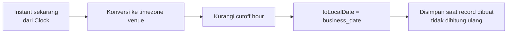
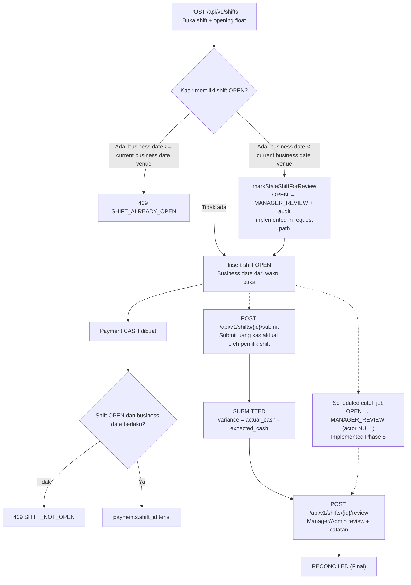
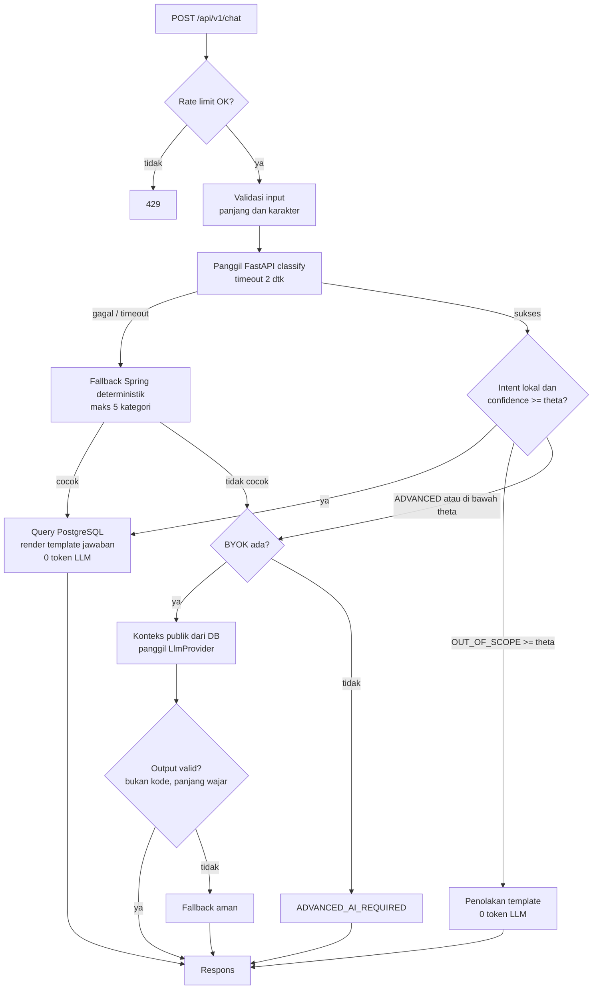

# APPLICATION_ARCHITECTURE — NightVenue

Pemilik: Backend (Claude + Qwen). Disetujui: PM (GPT). Pendamping: `PRD.md`, `DECISIONS.md` (seluruh ADR), `DATABASE.md`, `UML.md`.

**Status pembayaran:** M3-A (Payment Core dan GET Payment), V9 (schema Xendit QRIS), M3-B (Xendit Payment Requests v3 Create), M4-A (webhook terautentikasi, verifikasi Status API, deduplikasi, settlement) dan M4-B (reconciliation opt-in) **sudah diimplementasikan dan diuji secara lokal**. Validasi sandbox/provider Xendit masih pending; scheduler reconciliation default `enabled=false`. Ikuti kontrak M4 di ADR-022 dan runbook ADR-023.

---

## 1. Gambaran Sistem

```mermaid
flowchart TB
    subgraph Client["Browser"]
        FE["Next.js (nightvenue-frontend)"]
    end

    subgraph BE["nightvenue-backend (Docker Compose)"]
        API["Spring Boot API<br/>system of record"]
        ML["FastAPI ML service<br/>forecasting; intent classifier chat (Phase 10.2)"]
        PG[("PostgreSQL")]
        RD[("Redis")]
    end

    XEN["Xendit (M3-B Create implemented; M4-A/M4-B implemented; sandbox validation pending)"]
    LLM["Gemini / Groq<br/>BYOK"]

    FE -- "/api/* rewrite same-origin" --> API
    API --> PG
    API --> RD
    API -- "HTTP internal + X-Internal-Token" --> ML
    API --> XEN
    XEN -.->|M3-B: Create (implemented); M4-A: callback + settlement; M4-B: reconciliation (opt-in)| API
    API -. "hanya eskalasi chat dengan key" .-> LLM
```

| Komponen | Boleh | Tidak boleh |
|---|---|---|
| Spring Boot | Semua logika bisnis, auth, uang, stok, status, BusinessDateService; routing chat (Phase 10.3; BYOK LLM menyusul di 10.4) | — |
| FastAPI | Perhitungan forecast dari deret numerik; klasifikasi intent FR-ML-01/02 (Phase 10.2) | Akses DB, auth, checkout, payment, mutasi inventory/bottle, aturan transaksional |
| PostgreSQL | Sumber kebenaran | — |
| Redis | Cache menu, rate limit, refresh token | State bisnis utama |
| Frontend | Presentasi, validasi UX | Menjadi batas keamanan |

**Kegagalan FastAPI pada forecasting tidak menghentikan transaksi inti**: order, payment, void, bottle, dan shift tidak memakai `MlClient`; kegagalan forecast memberi 503 pada endpoint forecast saja.

---

## 2. Stack

Versi dipin di Phase 1 (ADR-018) dan dicatat di `CONTEXT.md`. Yang dikunci adalah keluarga teknologi.

| Lapisan | Teknologi |
|---|---|
| Frontend | Next.js (App Router), TypeScript strict, Tailwind, shadcn/ui, TanStack Query, Zustand, React Hook Form + Zod; no provider SDK in browser for planned Xendit flow |
| Backend | Java LTS, Spring Boot, Spring Security, Spring JDBC (`JdbcTemplate`), Flyway, MapStruct, springdoc-openapi, Actuator, rate limit via Redis |
| ML | Python, FastAPI, scikit-learn, pandas, joblib |
| Data | PostgreSQL, Redis |
| Test | JUnit 5, Mockito, Testcontainers, Vitest, RTL, pytest, k6 |
| CI/CD | GitHub Actions, GHCR, Vercel |

---

## 3. Struktur Repository

```text
nightvenue-backend/
├── api/src/main/java/com/nightvenue/api/
│   ├── common/        error, idempotency, security util, audit, Clock
│   ├── businessday/   BusinessDateService
│   ├── auth/
│   ├── venue/        IMPLEMENTED (Phase 4D): table CRUD (`TableController`, `TableService`, `TableRepository`)
│   ├── catalog/       product, category, ingredient, recipe
│   ├── inventory/     inventory, ledger, adjustment
│   ├── pos/           IMPLEMENTED (Phase 5A–5C): order, VOID and SERVE endpoints/services/repositories
│   ├── payment/       payment, PaymentGateway, webhook
│   ├── bottle/        vault, redeem, expiry job
│   ├── shift/         cashier shift (open, stale-shift transitions in request paths, submit, manager review, reconciliation, and background cutoff scheduler)
│   ├── forecast/      client ke ml-service
│   └── chat/          ChatRouter, fallback, LlmProvider, logging metrik
│   └── (resources)/db/migration/   Flyway V*__*.sql
├── ml-service/        app/, data/ (train, val, test), reports/, models/
├── infra/
├── docker-compose.yml
├── .github/workflows/{ci-api,ci-ml,docker}.yml
└── CONTEXT.md  README.md  .env.example  (+ salinan docs)

nightvenue-frontend/
├── src/app/           (staff)/pos, (staff)/inventory, (staff)/shift, (staff)/bottles, (customer)/..., demo chat
├── src/features/  components/  hooks/  lib/  services/  stores/
├── src/types/api.ts   DIGENERATE dari OpenAPI, jangan diedit manual
└── .github/workflows/ci.yml  CONTEXT.md  README.md  .env.example
```

Dua repo saja (ADR-008). Paket untuk fitur deferred (reservation, loyalty, transfer, report, recovery) **tidak dibuat**.

---

## 4. Layering Backend

```text
Controller → Service (@Transactional, aturan bisnis) → Repository
DTO in/out (validasi)                                   JdbcTemplate
```

1. Entity tidak keluar dari controller; selalu DTO.
2. `@Transactional` hanya di service; batas transaksi = satu use case.
3. Query atomic stok dan vault ditulis eksplisit melalui `JdbcTemplate`, bukan load-modify-save.
4. Otorisasi dua lapis: `@PreAuthorize` (role) dan pengecekan venue di service.
5. Panggilan HTTP eksternal (provider pembayaran, ML, LLM) **tidak boleh** di dalam transaksi yang memegang lock.
6. Waktu hanya dari `Clock` yang diinjeksi; business date hanya dari `BusinessDateService` (ADR-001).
7. Controller chat, order, dan payment tidak saling memanggil lewat HTTP internal.
8. Urutan lock tetap: baris `orders` → `payments` → `inventory_items` (ID menaik). Jangan dibalik; add-item, payment, webhook, dan VOID semuanya mengikuti urutan ini.

---

## 5. Konvensi API

| Hal | Aturan |
|---|---|
| Prefix | `/api/v1/*` (perubahan breaking → `/api/v2`). Actuator tidak diberi prefix |
| Format error | RFC 7807 `application/problem+json` (`type`, `title`, `status`, `detail`, `traceId`, `errors[]`) |
| Idempotency | `Idempotency-Key` (UUID) wajib pada pembukaan order (`ORDER_OPEN`), tambah item, payment, VOID, deposit, dan redeem. Unique `(scope, user, key)`; request identik diputar ulang, payload berbeda ditolak. Retensi minimum 24 jam; cleanup ditunda ke fase berikutnya. |
| Paginasi | `page`, `size` (maks 100) |
| Correlation | `X-Request-Id` masuk MDC dan respons |
| Status | 400 validasi, 401, 403 role, 404 tidak ada / di luar venue, 409 konflik (stok, state, duplikat, shift), 422 aturan bisnis, 429 rate limit |
| Kontrak | OpenAPI dari springdoc; tipe FE digenerate; CI FE gagal bila berubah tanpa pembaruan |

**Permukaan API (indikatif, kontrak final = OpenAPI).** Semua path aplikasi diawali `/api/v1`; FastAPI internal memakai `/ml/*`.

| Area | Endpoint |
|---|---|
| Auth | `POST /api/v1/auth/login`, `/api/v1/auth/refresh`, `/api/v1/auth/logout`; `GET /api/v1/auth/me` |
| Katalog / inventory | `/api/v1/products`, `/api/v1/ingredients`, `/api/v1/recipes`, `/api/v1/inventory`, `POST /api/v1/inventory/{id}/adjust` |
| Venue / tables | **IMPLEMENTED (Phase 4D):** `/api/v1/tables`. **Phase 5A guard:** manual release or delete is blocked while an active order exists. |
| Order | **IMPLEMENTED (Phase 5A):** `POST /api/v1/orders` requires `Idempotency-Key` (UUID); same key and payload replays the original 201 response snapshot, while a changed payload returns 422. `GET /api/v1/orders/{id}`; roles ADMIN, MANAGER, CASHIER; access outside the user's venue returns 404. **IMPLEMENTED (Phase 5B):** `POST /api/v1/orders/{id}/items` (Stock-at-Order deduction, Idempotency-Key, order totals recalculation). **IMPLEMENTED (Phase 5C):** `POST /api/v1/orders/{id}/void` (whole-order VOID), `POST /api/v1/orders/{id}/items/{itemId}/serve` (per-item SERVE). |
| Payment | `POST /api/v1/orders/{id}/payments` (CASH, CARD_EDC, QRIS implemented; path documented in `openapi.yaml`); `GET /api/v1/payments/{paymentId}` (implemented; roles ADMIN, MANAGER, CASHIER; unknown or cross-venue id → 404; documented in `openapi.yaml`); `POST /api/v1/webhooks/xendit` (token verification + Status API verification implemented; not described in `openapi.yaml`; provider contract and M4 behavior in ADR-022) |
| Bottle | `POST /api/v1/bottles` (deposit, `Idempotency-Key`, roles ADMIN/MANAGER/CASHIER), `POST /api/v1/bottles/redeem` (roles ADMIN/MANAGER/CASHIER), `GET /api/v1/bottles` (roles ADMIN/MANAGER/CASHIER), `GET /api/v1/customers/me/bottles` (role CUSTOMER only; JWT sub -> customers.user_id, exclude staff) |
| Shift | `POST /api/v1/shifts` (Phase 6 implemented: open shift, one OPEN per cashier, stale OPEN → `MANAGER_REVIEW` + audit; documented in `openapi.yaml`); `POST /api/v1/shifts/{id}/submit` dan `POST /api/v1/shifts/{id}/review` (Phase 8 implemented: submit uang kas oleh pemilik shift, review/rekonsiliasi oleh manager/admin; documented in `openapi.yaml`); tidak ada endpoint `GET` daftar shift |
| Forecast | `POST /api/v1/forecasts` (ADMIN/MANAGER; tidak ada GET) |
| Chat | `POST /api/v1/chat` (anonim, rate-limited; terimplementasi di Phase 10.3 (branch lokal, belum di-push, menunggu penerimaan PM); detail di 7.7) |
| FastAPI (internal) | `POST /ml/forecast/inventory`, `GET /health`; `POST /ml/chat/classify` (Phase 10.2, internal, `X-Internal-Token`) |

---

## 6. Keamanan

| Topik | Rancangan |
|---|---|
| Password | BCrypt |
| Access token | JWT HS256, issuer `nightvenue`, TTL default 15 menit; klaim `sub`, `role`, `iss`, `iat`, `exp`. Backend mengembalikannya di body dan tidak dapat membuktikan penyimpanan FE di memori |
| Refresh token | Token acak 256-bit non-JWT; hanya SHA-256 disimpan di Redis dan diputar atomik lewat Lua. Cookie `nv_refresh`: `HttpOnly; Secure; SameSite=Lax; Path=/api/v1/auth` (ADR-009) |
| Same-origin | Browser hanya memanggil origin FE; Next.js `rewrites` meneruskan `/api/*` |
| CORS | Whitelist eksplisit |
| Otorisasi | Role eksplisit/non-hierarkis; venue aktif dan penugasan dibaca dari DB pada setiap request. Venue di luar akses dibalas 404 |
| Refresh reuse | Kebijakan strict: reuse tombstone mencabut seluruh family refresh milik user dan menulis audit. Dua refresh paralel dengan token sama dapat membuat request yang kalah mencabut semua sesi; FE wajib single-flight |
| Sesi | Tidak ada umur absolut maksimum pada Month-1. Access JWT tetap berlaku sampai `exp` setelah sesi dicabut/dinonaktifkan; `/me` dan refresh memeriksa status DB |
| CSRF | CSRF Spring dinonaktifkan untuk API stateless; refresh/logout menggunakan POST dan cookie SameSite=Lax pada same-origin |
| Xendit callback (implemented, M4-A) | `POST /api/v1/webhooks/xendit`: token verification + Get Payment Request (Status API) verification implemented; deduplication via unique `(provider, event_key)`; settlement implemented after authenticated, correlated, Status-API-verified evidence |
| Rate limit | Redis token bucket Lua: login 5/IP/menit, refresh 10/IP/menit, logout 20/IP/menit, `/me` 30/user/menit. Redis gagal → 503. IP memakai `request.getRemoteAddr()` setelah Tomcat memproses proxy tepercaya; `X-Forwarded-For` tidak dibaca manual |
| Rate-limit caveat | Semua kasir pada satu IP publik berbagi bucket. Vercel tidak memiliki IP egress tetap; batas per-IP produksi best-effort sampai ADR-019 diputuskan dan rewrite FE diverifikasi |
| BYOK | Key di header `X-AI-Key`, hanya untuk request itu; **transit melalui server**; tidak disimpan, tidak dicatat, tidak masuk telemetry error (ADR-013) |
| Secret | Hanya env; `.env.example` tanpa nilai nyata; gitleaks di CI |
| Log | Dilarang mencatat password, token, `X-AI-Key`, isi `/chat`; header sensitif difilter |
| Internal ML | Hanya jaringan Docker, `X-Internal-Token`, port tidak dipublikasikan |
| PII | Tidak menyimpan nomor identitas; chat tidak dipersistensi |

**Refresh token single-flight contract:** Frontend wajib mengantrikan request refresh (tidak paralel). Dua refresh paralel dengan token sama akan memicu reuse detection → seluruh sesi user dicabut (lihat Addendum ADR-009 v2.1). Implementasi frontend: gunakan queue atau mutex di state manager (Zustand/Redux) sebelum memanggil `/auth/refresh`.

### 6.1 Accepted trade-offs (Phase 3)

1. **Tidak ada expiry absolut sesi:** TTL family diperpanjang setiap rotasi token berhasil (inaktivitas-based expiry). Sesi tetap hidup selama user aktif melakukan rotasi berkala.
2. **Kredensial dan role dipercaya dari JWT sampai access token kedaluwarsa:** Perubahan role atau penonaktifan user di database memiliki propagation delay maksimal sepanjang TTL access token (15 menit). Jendela ini dipersempit oleh re-check status database saat rotasi refresh token dan pemanggilan `/api/v1/auth/me`.
3. **Strict reuse tanpa grace window:** Deteksi penggunaan ulang refresh token langsung mencabut seluruh sesi keluarga (family revocation) tanpa masa tenggang toleransi network retry. Frontend wajib menjamin single-flight refresh.
4. **Lua script single-node Redis:** Skrip atomik rotasi refresh token dan token bucket rate limit dirancang untuk single-node Redis (multi-key beroperasi pada instance yang sama), belum mendukung sharding otomatis Redis Cluster tanpa hash tagging menyeluruh.
5. **Rate limit berbasis IP pemanggil:** Seluruh kasir atau staf pada satu venue fisik yang berbagi koneksi internet (NAT publik tunggal) berbagi kapasitas bucket IP yang sama.
6. **Kebutuhan SameSite=Lax:** Cookie autentikasi `nv_refresh` memakai atribut `SameSite=Lax`, mensyaratkan arsitektur frontend berada pada domain/origin yang sama (melalui Next.js API route rewrites) agar cookie otomatis terkirim pada navigasi lintas rute API.

---

## 7. Alur Kritis

### 7.1 Business Date



Hanya `BusinessDateService` yang melakukan ini. Contoh dan tabel batas ada di ADR-001.

### 7.2 Tambah item ke order (Stock-at-Order)

Satu transaksi DB:

```text
1. Validasi order OPEN/PARTIALLY_PAID dan venue user; cek Idempotency-Key
2. Kunci baris order: SELECT ... FROM orders WHERE id = :id FOR UPDATE
   (menserialkan add-item, payment, dan VOID pada order yang sama)
3. Produk is_bottle_keepable: quantity harus 1, selain itu 422 (BR-29)
4. INSERT order_items (snapshot nama dan harga, status ORDERED) -> dapat order_item_id
5. Ambil recipe tiap item; bentuk pasangan (item, ingredient, kebutuhan)
   dan urutkan menurut ingredient_id ASC
6. Untuk tiap pasangan pada lokasi BAR venue:
     UPDATE inventory_items
        SET quantity = quantity - :need, version = version + 1
      WHERE location_id = :bar AND ingredient_id = :ing AND quantity >= :need;
     rows = 0 -> rollback seluruhnya (order_item dari langkah 4 ikut batal),
                 409 INSUFFICIENT_STOCK (sebut bahan)
     rows = 1 -> INSERT inventory_transactions
                 (SALE_DEDUCT, delta, balance_after, business_date,
                  reference_type ORDER_ITEM, reference_id = order_item_id)
7. Hitung ulang subtotal/service/pajak/total_due
```

Mengapa bukan optimistic lock: bahan populer adalah baris panas; konflik versi memicu retry berantai. Conditional UPDATE menjadikan database penjaga invarian; urutan ID mencegah deadlock (ADR-003).

### 7.3 Pembayaran dan webhook

**Invarian konkurensi (ADR-005, BR-28):** pembuatan payment diserialkan terhadap baris order. Di dalam transaksi pembuatan: `SELECT ... FROM orders WHERE id = :id FOR UPDATE`, hitung `sisa = total_due − SUM(PAID) − SUM(PENDING)`, tolak 422 bila `amount > sisa`, lalu INSERT payment. Payment `PENDING` ikut menahan sisa, sehingga dua request berbeda `Idempotency-Key` tidak dapat melampaui tagihan. `Idempotency-Key` hanya melindungi request yang sama, bukan masalah ini.

**CASH / CARD_EDC:** satu transaksi (lock order, validasi sisa, INSERT payment `PAID`, hitung penutupan order). **Setiap payment CASH wajib teratribusi ke shift `OPEN` milik pemrosesnya, apa pun rolenya** (Manager/Admin yang menerima tunai membuka shift sendiri, lihat 7.6); tanpa itu 409 `SHIFT_NOT_OPEN`.

**Xendit QRIS flow — M3-B implemented (TX1 → external HTTP → TX2 dengan CAS fencing); M4-A (webhook terautentikasi, verifikasi Status API, deduplikasi, settlement) dan M4-B (reconciliation opt-in) implemented dan diuji lokal.** External calls remain outside database transactions and order locks. M4-A verifies authenticated callbacks, deduplicates events, correlates provider evidence, and settles only after verification. Reconciliation scheduler defaults to `enabled=false` (config: `nightvenue.payment.reconciliation.enabled`). Validasi sandbox/provider Xendit masih pending.

1. TX1 locks the order, validates the remaining amount, inserts payment `PENDING` (reserving the amount), and commits.
2. M3-B calls Xendit Create outside the transaction/lock. Exact QRIS `channel_properties`, action descriptor/payload, expiry request, and Create idempotency behavior remain OPEN.
3. On a confirmed response, M3-B stores available provider identifiers. V9 adds `provider_reference_id` for NightVenue's `reference_id` and nullable `provider_request_id VARCHAR(39)` for `payment_request_id`; `provider_transaction_id` remains nullable and its exact Xendit `payment_id` mapping is OPEN_QUESTION.
4. An ambiguous Create outcome (timeout, dropped connection, or uncertain 5xx) must never cause an automatic second Create. Initially keep payment status `PENDING`, its reservation active, and BR-20 VOID protection active. V9 adds `charge_state=AMBIGUOUS`; M4-A may settle it to `PAID` only after authenticated and correlated provider evidence, without changing the charge state. Do not add `PENDING_MANUAL_REVIEW` to the payment status enum.
5. If `payment_request_id` was not received, recovery by NightVenue `reference_id` has not been verified. Do not retry Create or claim lookup is possible; the operator/reconciliation procedure is OPEN. A Get request can only use a confirmed provider ID and the provider's verified status semantics.

M4-A validates the webhook callback token and separately protects against duplicate events. Correlation uses `reference_id`, `business_id`, `currency`, `amount`, `payment_id`, and `payment_request_id`. An authenticated webhook may recover a missing `payment_request_id`; do not assume Get Payment Request supports `reference_id` lookup because its path requires `payment_request_id`. Only authenticated and correlated provider evidence may settle `AMBIGUOUS` to `PAID`; keep `charge_state=AMBIGUOUS`. Provider responses/callbacks never replace NightVenue as the source of truth. M4-B runs the same Status API verification as an opt-in reconciliation cycle for queryable candidates (`PaymentReconciliationService`), with `enabled=false` by default.

```mermaid
sequenceDiagram
    participant K as Kasir (FE)
    participant A as Spring Boot
    participant D as PostgreSQL
    participant X as Xendit (M3-B Create implemented)

    K->>A: POST /api/v1/orders/id/payments (QRIS, amount, Idempotency-Key)
    A->>D: TX1: kunci baris order, validasi sisa, INSERT payment PENDING, COMMIT
    A->>X: M3-B: Create (outside transaction/lock)
    alt confirmed Create response
        X-->>A: provider response (QRIS shape remains OPEN)
        A->>D: TX2: persist confirmed provider identifiers
        A-->>K: safe payment/QR data via NightVenue backend
    else ambiguous Create outcome
        X--xA: timeout / connection drop / uncertain 5xx
        Note over A,D: No second Create; status stays PENDING, reservation and BR-20 guard stay active
        A->>D: persist separate recovery state (AMBIGUOUS; V9)
    end

    Note over A,X: M4-A callback verification, deduplication and settlement are implemented and tested locally; provider sandbox validation is still pending
```

Duplikat dideteksi lewat `INSERT ... ON CONFLICT DO NOTHING` (0 baris), bukan dengan menangkap exception di transaksi utama, karena di PostgreSQL pelanggaran unique membatalkan transaksi. Pengiriman duplikat tidak menambah baris `payment_events`; buktinya log terstruktur (`event_key`, `payment_id`).

Bila order sudah `VOIDED` saat settlement tiba: payment dicatat `PAID`, order tetap `VOIDED`, `audit_logs` menerima `PAYMENT_ON_CLOSED_ORDER` (BR-21).

### 7.4 VOID (kompensasi)

Satu transaksi:

```text
1. Validate body/key; read order and authorize venue before any replay path.
2. Reject explicit CASHIER WASTED; reserve/replay idempotency; lock order; reject non-OPEN status; enforce cashier threshold/SERVED approval.
3. Conditionally transition OPEN → VOIDED and capture one batch UUID. Write all per-item `void_logs` first, with SERVED items effectively WASTED.
4. Transition all ORDERED/SERVED items to VOIDED. For RESTORED ORDERED items, batch-read SALE_DEDUCT rows ordered by `inventory_items.id`, `order_item_id`, then ledger ID; lock each inventory row once and append one matching VOID_RETURN per deduction.
5. Write ORDER_VOID audit; conditionally release an occupied table (zero rows is invariant failure); serialize and complete the idempotency response.

The VOID transaction uses one captured instant, preserves financial snapshots, and had no PENDING/PAID payment guard in Phase 5C; the BR-20 guard was implemented in Phase 6 (VOID is rejected with 409 while a PENDING or PAID payment exists; see ADR-021 addendum). SERVE locks the parent order first, allows OPEN/PARTIALLY_PAID/PAID, and conditionally transitions one ORDERED item to SERVED.
```

Pengembalian dibaca dari ledger, bukan dari recipe saat ini (ADR-004).

### 7.5 Bottle: deposit dan redeem

Deposit (`Idempotency-Key`; item produk `is_bottle_keepable` dengan `quantity = 1` pada order `PAID`, customer `age_verified`, item belum punya vault karena `source_order_item_id` UNIQUE, BR-29, item_type `PRODUCT`, item status bukan `VOIDED`, D11):
- Customer pemilik botol diambil strictly dari `order.customer_id`. Walk-in order tanpa customer (`order.customer_id IS NULL`) ditolak (422 `CUSTOMER_REQUIRED`) dan tidak dapat deposit pada versi ini.
- Operasi mengunci baris order terkait (`FOR UPDATE`) terlebih dahulu.
- Buat vault `ACTIVE`, buat token acak 128-bit, simpan hash SHA-256 (`qr_token_hash`), kembalikan token mentah **sekali**, tulis `DEPOSIT` (`performed_by = actor`).
- `expiry_date` dihitung: business date deposit + 30 hari (konfigurasi D7). Botol dapat di-redeem sepanjang hari expiry_date; kedaluwarsa bila `businessDate > expiry_date`.
- Replay deposit mengembalikan data vault tanpa token mentah. Request kedua dengan key berbeda untuk item yang sama ditolak dengan pesan detail `VAULT_ALREADY_EXISTS` (HTTP 409).
- Format respon error adalah RFC 7807 ProblemDetail tanpa field kode mesin; `VAULT_ALREADY_EXISTS` muncul sebagai teks pesan dalam `detail`.

Redeem (`Idempotency-Key`; body: `qrToken`, `orderId`, `volumeMl`, `ownerConfirmed`):

```text
1. Kunci order row FOR UPDATE; periksa status OPEN atau PARTIALLY_PAID (D4), periksa order.total_due > 0 (D9; 422 bila <= 0, tanpa endpoint close).
2. Cari vault dari hash(qrToken); periksa vault.venue_id == order.venue_id (D8), order.customer_id harus = vault.customer_id; ownerConfirmed wajib true (422 jika false).
3. Tambah order_item BOTTLE_REDEMPTION lewat jalur DEDICATED (bypassing addItems, tanpa pemotongan inventory/resep; D5, D10: harga 0, line_total 0).
4. UPDATE bottle_vaults
      SET remaining_volume_ml = remaining_volume_ml - :ml,
          status = CASE WHEN remaining_volume_ml - :ml = 0 THEN 'EMPTY' ELSE status END,
          version = version + 1
    WHERE id = :id AND status = 'ACTIVE'
      AND expiry_date >= :businessDate AND remaining_volume_ml >= :ml;
   rows = 0 -> 409 (habis / kedaluwarsa / tidak aktif), rollback
5. INSERT bottle_vault_transactions (REDEEM, -ml, remaining_after, owner_confirmed, performed_by)
```
Ini bukan autentikasi kuat (ADR-020).

Kompensasi VOID (D3): `OrderLifecycleService.voidOrder` mengunci baris order terlebih dahulu. Jika order memuat item `BOTTLE_REDEMPTION`, void langsung ditolak dengan HTTP 409 Conflict sebelum proses restore atau mutasi stok, terlepas dari disposition RESTORED atau WASTED. Reservasi idempotency di-rollback. Tidak ada kompensasi vault volume pada void.

Isolasi Otorisasi: Seluruh endpoint staf (`/api/v1/bottles/**`) mengecualikan role `CUSTOMER` (hanya `ADMIN`, `MANAGER`, `CASHIER`) dan diverifikasi terhadap venue penugasan via `VenueAccessService`. Endpoint `GET /api/v1/customers/me/bottles` hanya mengizinkan role `CUSTOMER` dan memetakan JWT `sub` langsung ke `customers.user_id`.

### 7.6 Shift dan cutoff



`expected_cash = opening_float + SUM(amount) payment CASH PAID dengan shift_id` (BR-23; `method = 'CASH' AND status = 'PAID'`).

**Status implementasi Phase 8.** Fondasi pembukaan shift dan transisi stale shift pada jalur request berasal dari Phase 6: `ShiftService.openShift` memeriksa shift OPEN milik kasir; bila `business_date` shift tersebut sama atau lebih baru dari current business date venue, request ditolak 409 `SHIFT_ALREADY_OPEN`. Bila lebih lama, `ShiftRepository.markStaleShiftForReview` melakukan transisi `OPEN` → `MANAGER_REVIEW` dengan `forced_review_at` dan audit `SHIFT_FORCED_REVIEW`, lalu shift baru dibuat secara atomik.

Pada Phase 8, alur penutupan dan rekonsiliasi shift telah diimplementasikan penuh:
1. **Transisi stale pada jalur request**: Terjadi pada dua jalur spesifik:
   - `POST /api/v1/shifts` saat shift owner membuka shift baru ketika masih memiliki shift open dari business date sebelumnya.
   - `POST /api/v1/shifts/{id}/submit` saat shift owner mencoba submit shift yang sudah lewat business date-nya (ditolak 409 `SHIFT_NOT_OPEN` setelah dialihkan ke `MANAGER_REVIEW`).
2. **Scheduled cutoff job mandiri**: `ShiftCutoffService.runCutoff()` dan `ShiftCutoffScheduler` berjalan secara independen di latar belakang, memindai seluruh venue dengan shift open, dan mengalihkan shift stale ke `MANAGER_REVIEW` dengan audit `SHIFT_FORCED_REVIEW` (actor `NULL`). Job ini aman dijalankan konkuren antar instansi aplikasi tanpa leader election karena conditional update pada database.
3. **Submit uang kas**: Pemilik shift memasukkan hitungan fisik uang kas (`POST /api/v1/shifts/{id}/submit`). Sistem menghitung `expected_cash = opening_float + SUM(amount)` di mana `shift_id = shift.id AND method = 'CASH' AND status = 'PAID'`, menghitung `variance = actual_cash - expected_cash`, dan mengubah status ke `SUBMITTED`.
4. **Manager review & rekonsiliasi**: Manager/admin merekonsiliasi shift (`POST /api/v1/shifts/{id}/review`). Status berubah menjadi `RECONCILED` (final dan tidak dapat direview ulang melalui workflow review shift). Pemilik shift dilarang mereview shift miliknya sendiri (`reviewed_by <> cashier_id`). Catatan review wajib diisi jika `variance <> 0` atau `forced_review_at IS NOT NULL`.

Phase 8 cutoff scheduler defaults to disabled (`nightvenue.shift.cutoff.enabled=false`). Each actual deployment must explicitly set `NIGHTVENUE_SHIFT_CUTOFF_ENABLED=true`; tests should call the cutoff service directly and must not start the scheduler.

Semua role yang menerima CASH memakai shift miliknya sendiri, dan reviewer tidak boleh pemilik shift yang direview (BR-30).

### 7.7 Hybrid chat

Status: classifier (10.2) dan Spring chat API dengan routing ADR-011 (10.3) terimplementasi di branch lokal, belum di-push, menunggu penerimaan PM. Jalur BYOK/LLM pada diagram (node K, LLM, O, SAFE) adalah rencana Phase 10.4 dan belum diimplementasikan; di 10.3 jalur tersebut berakhir di ADVANCED_AI_REQUIRED.



Terimplementasi di 10.3: setiap respons 200 menulis satu baris `chat_route_logs` (rute, intent, confidence, latensi, `ml_available`) tanpa isi pesan dan tanpa key. Kolom token dan estimasi biaya baru relevan saat LLM (10.4/10.5).

**Mode gagal (terimplementasi di 10.3)**: classifier timeout atau tidak tersedia -> fallback Spring deterministik, lalu `ADVANCED_AI_REQUIRED` bila tidak cocok (`ml_available=false`); Redis rate limit tidak tersedia -> 503 "Chat service temporarily unavailable"; insert `chat_route_logs` gagal -> 503 tersanitasi tanpa `answer` dan tanpa baris tersimpan (fail-closed); `ChatServiceUnavailable` sengaja dilempar tanpa cause karena `ApiExceptionHandler` menelusuri cause chain. Kegagalan chat tidak pernah menyentuh order atau payment.

**Pemetaan intent → sumber jawaban lokal (terimplementasi di 10.3 untuk sembilan intent lokal; ADVANCED_CONVERSATION di 10.3 menghasilkan ADVANCED_AI_REQUIRED, eskalasi LLM di 10.4)**

| Intent | Sumber | Catatan |
|---|---|---|
| OPENING_HOURS | `venues.opening_hours` | |
| VENUE_AREA | `venue_tables.area` (distinct + jumlah meja) | |
| MENU_INFORMATION | `products` aktif per kategori | |
| BOTTLE_KEEPING | `venue_faqs` (kebijakan) | |
| MINIMUM_SPEND | `venue_tables.minimum_spend` per area | |
| PROMOTION | `promotions` aktif pada business date sekarang | |
| TABLE_AVAILABILITY | `venue_tables.status = AVAILABLE` saat ini | Bukan ketersediaan tanggal mendatang (reservasi deferred) |
| RESERVATION | `venue_faqs` | Menyatakan reservasi belum tersedia di versi ini |
| GENERAL_VENUE_INFORMATION | `venues.address` + `venue_faqs` | |
| ADVANCED_CONVERSATION | Eskalasi LLM | |
| OUT_OF_SCOPE | Penolakan template | |

**Fallback Spring deterministik (maksimal lima kategori, ADR-012; terimplementasi di 10.3)**: jam buka, alamat venue, minimum spend, area venue, kebijakan bottle keeping; regex/keyword.

**Kontrak ML Phase 10.2 (terimplementasi di ml-service; contoh berikut hanya menunjukkan bentuk, kontrak otoritatif mengikuti implementasi)** (intent classifier FR-ML-01/02):

```json
// POST /ml/chat/classify
{ "message": "kalau jam 2 pagi masih buka?" }
// response
{ "intent": "OPENING_HOURS", "confidence": 0.91, "requiresLlm": false, "modelVersion": "..." }

// Internal POST /ml/forecast/inventory
// Request and response follow MlForecastRequest and MlForecastResponse.
// The response includes selectedModel, modelName, modelMae, baselineMae,
// predictedQuantity, inputDays, and asOfBusinessDate.
```
Angka pada contoh adalah tempat pengisi format, bukan hasil. `series` berasal dari ledger per `business_date`: `net_consumption = -(SUM(delta WHERE type IN ('SALE_DEDUCT','VOID_RETURN')))`. Contoh: SALE_DEDUCT −10 dan VOID_RETURN +4 menghasilkan konsumsi bersih 6 (bukan 14).

### 7.8 Forecasting

```text
ADMIN/MANAGER → POST /api/v1/forecasts
 → Spring memeriksa role dan akses venue; venue di luar akses menghasilkan 404
 → Spring mengagregasi ledger dan membangun seri harian sampai asOfBusinessDate
 → Spring memanggil FastAPI untuk menghitung regresi dan baseline; timeout default 10.000 ms
 → Spring menyimpan hasil sukses ke stock_forecasts
 → kegagalan forecast ML menghasilkan 503 pada endpoint forecast
```

FastAPI tidak mengakses database; komunikasi hanya melalui jaringan Docker Compose menggunakan token internal (`X-Internal-Token`).

`ForecastService.forecast` tidak memakai `@Transactional`, sehingga transaksi DB tidak membungkus pemanggilan ML. Pencarian kode Java utama menemukan `MlClient` hanya di paket `forecast`, dipakai oleh `ForecastService`; ini fakta struktur kode, bukan klaim hasil tes.

**Seri input:** Spring mengambil ledger dari `asOfBusinessDate - 89 hari` sampai `asOfBusinessDate`, inklusif. Builder memulai pada tanggal baris ledger pertama di jendela tersebut dan mengisi tanggal harian sampai asOf inklusif. Jendela paling panjang 90 hari; jumlah observasi minimum `max(28, 21 + horizonDays)`. Gap di dalam rentang menjadi 0. Builder tidak mengisi tanggal sebelum baris pertama atau sesudah asOf. Alur ini mengasumsikan ledger mencatat seluruh pergerakan yang relevan; skema tidak memiliki tabel kalender buka/tutup venue.

Net harian negatif diubah menjadi 0 oleh builder; ledger tidak berubah. `VOID_RETURN` memakai business date saat void, bukan tanggal `SALE_DEDUCT` awal. Karena itu void yang terjadi belakangan tidak mengurangi konsumsi pada tanggal penjualan di seri forecast. Ini penyederhanaan input, bukan rekonsiliasi akuntansi. Perbaikan kelak dapat mengaitkan void ke penjualan melalui `void_logs.order_item_id`.

`predictedQuantity` adalah jumlah kumulatif prediksi harian non-negatif selama horizon. `modelMae` adalah mean absolute error regresi pada `horizonDays` observasi terakhir dari input, dengan model dilatih pada observasi sebelumnya; `baselineMae` memakai cara ukur yang sama untuk baseline rata-rata hari yang sama. `modelName` menyebut nama metode pemenang (`ols_weekday_trend` atau `baseline_dow_mean`), sedangkan `selectedModel` bernilai `REGRESSION` atau `BASELINE`. MAE lebih rendah memilih metode; jika MAE sama (tie), REGRESSION dipilih. Evaluasi Evidence C menunjukkan pemilihan dapat kalah dari kedua MAE metode pada held-out: bahan B (GRAM), selected 38.413, regresi 37.706, baseline 37.335. Angka Evidence C berasal dari data sintetis, bukan akurasi produksi.

**Error API:** respons memakai ProblemDetail tanpa properti `code`. Pre-check lokal yang kekurangan data memberi 422 dengan detail `INSUFFICIENT_DATA: available=X required=Y`. Upstream 422 dengan `INSUFFICIENT_DATA` atau `INVALID_SERIES` memberi 422 dengan detail sama dengan kode upstream. Kegagalan upstream/transport lain, termasuk timeout, connection error, 5xx, 401/404, respons 200 malformed atau tidak lengkap, dan 422 tanpa kode, memberi 503 dengan detail `Forecast service unavailable`. Body upstream dan nilai internal token tidak dikembalikan.

Nilai JSON bertipe number tidak menjamin skala desimal yang sama, misalnya `12.5` atau `12.500`; database menyimpan `predicted_quantity` sebagai `NUMERIC(14,3)`. Route hanya POST. Tidak ada UNIQUE atau idempotensi untuk forecast; dua request sukses membuat dua baris `stock_forecasts`. Tabel menyimpan `model_name` dan kedua MAE; respons API juga membawa `selectedModel`.

---

## 8. Redis

| Key | Isi | TTL |
|---|---|---|
| `menu:{venueId}` | Cache katalog POS | Singkat; invalidasi saat produk berubah |
| `rl:{scope}:{ip\|userId}` | Token bucket | Sesuai window |
| `rt:tok:{sha256(raw)}` | `familyId`, `userId`, status `ACTIVE`/`USED`; status `USED` adalah tombstone deteksi reuse | TTL refresh (tombstone kedaluwarsa sendiri) |
| `rt:fam:{familyId}` | `userId`, hash token saat ini; keberadaan key menandakan family aktif | Diperpanjang tiap rotasi |
| `rt:user:{userId}` | Set seluruh `familyId` user untuk pencabutan semua sesi | Diperpanjang tiap rotasi |

Rotasi, pembuatan family, logout family, dan pencabutan semua family memakai Lua atomik. Desain akses key dinamis ini mendukung Redis single-node; Redis Cluster tidak didukung.

Kehilangan Redis hanya memaksa login ulang dan cache dingin; tidak boleh merusak data bisnis.

## 9. Observability

Log JSON terstruktur + `X-Request-Id` di MDC; `/actuator/health` (liveness/readiness DB dan Redis); `GET /health` FastAPI; Docker healthcheck memakai endpoint tersebut. Metrik dan error tracking menyusul setelah core stabil.

## 10. Konfigurasi (env)

| Variabel | Keterangan |
|---|---|
| `SPRING_DATASOURCE_URL/USERNAME/PASSWORD`, `REDIS_URL` | Data |
| `JWT_SECRET`, `JWT_ACCESS_TTL`, `JWT_REFRESH_TTL` | Token |
| `AUTH_COOKIE_SECURE` | Default `true`; `false` hanya pada profil `dev`/`test` |
| `AUTH_RATE_LIMIT_*`, `AUTH_RATE_LIMIT_*_PERIOD` | Kapasitas dan periode token bucket tiap endpoint auth |
| `APP_TRUSTED_PROXIES` | Regex alamat proxy internal Tomcat; isi hanya proxy yang dipercaya |
| `NIGHTVENUE_OPENAPI_PUBLIC` | Membuka dokumen OpenAPI hanya bila diaktifkan eksplisit pada lingkungan non-produksi |
| Xendit credentials/configuration | Property names: `nightvenue.payment.xendit.secret-key`, `base-url`, `api-version`, `connect-timeout-ms`, `read-timeout-ms`, `callback-token`. Values and deployment policy require separate implementation/configuration approval. |
| `ML_SERVICE_URL`, `ML_INTERNAL_TOKEN`, `ML_CLASSIFY_TIMEOUT_MS`, `ML_FORECAST_TIMEOUT_MS` | Antar-service |
| `CHAT_CONFIDENCE_THRESHOLD`, `CHAT_RATE_LIMIT_PER_MIN`, `LLM_PRICING_CONFIG` | Chat dan estimasi biaya |
| `APP_CORS_ALLOWED_ORIGINS`, `APP_TRUSTED_PROXIES` | Keamanan |
| Frontend: `API_BASE_URL` (target rewrite) | Browser never calls Xendit directly and receives no Xendit secret |

Tidak ada variabel untuk API key LLM (BYOK, tidak disimpan). Tidak ada konfigurasi SMTP (password recovery deferred).

## 11. Deployment

| Lingkungan | Cara |
|---|---|
| Lokal backend | `docker compose up` (api, ml-service, postgres, redis) |
| Lokal frontend | `npm run dev`, rewrite ke `http://localhost:8080` |
| Local provider callback | Route and testing approach VERIFY — no operational evidence yet; requires approved provider sandbox validation |
| FE produksi | Vercel (preview per PR) |
| BE produksi | Image GHCR → hosting hasil spike (ADR-019) → health check pasca-deploy |

## 12. ADR

Seluruh ADR ada di `DECISIONS.md`. ADR baru wajib diajukan tertulis ke PM sebelum diimplementasikan.
