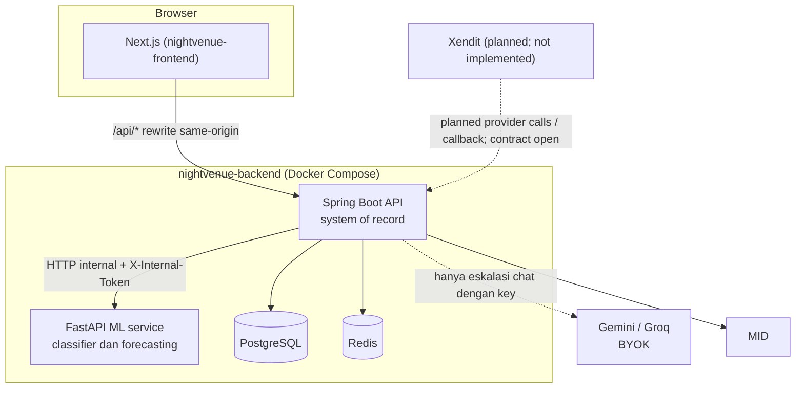
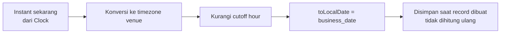
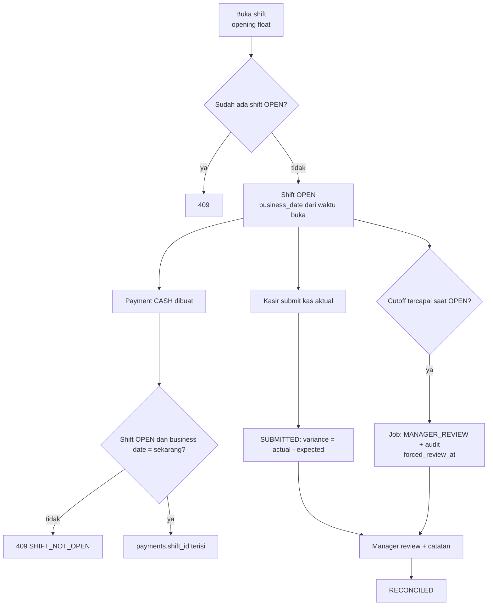
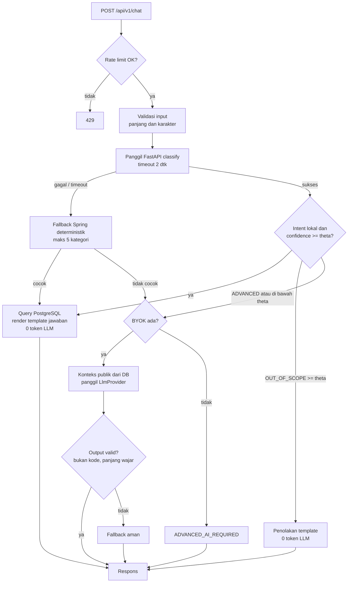

# APPLICATION_ARCHITECTURE — NightVenue

Pemilik: Backend (Claude + Qwen). Disetujui: PM (GPT). Pendamping: `PRD.md`, `DECISIONS.md` (seluruh ADR), `DATABASE.md`, `UML.md`.

**Status pembayaran:** M3-A and V9 are approved. M3-B provider integration and M4 settlement are not implemented in this closure; follow the binding M4 contract in ADR-022.

---

## 1. Gambaran Sistem



| Komponen | Boleh | Tidak boleh |
|---|---|---|
| Spring Boot | Semua logika bisnis, auth, uang, stok, status, BusinessDateService, routing chat | — |
| FastAPI | Klasifikasi intent; prediksi stok dari deret numerik | Akses DB, auth, checkout, payment, mutasi inventory/bottle, aturan transaksional |
| PostgreSQL | Sumber kebenaran | — |
| Redis | Cache menu, rate limit, refresh token | State bisnis utama |
| Frontend | Presentasi, validasi UX | Menjadi batas keamanan |

**Kegagalan FastAPI tidak menghentikan transaksi inti**: order, payment, void, bottle, dan shift tidak memanggil FastAPI. Hanya chat dan forecasting yang bergantung padanya, dan chat memiliki fallback (bagian 7.6).

---

## 2. Stack

Versi dipin di Phase 1 (ADR-018) dan dicatat di `CONTEXT.md`. Yang dikunci adalah keluarga teknologi.

| Lapisan | Teknologi |
|---|---|
| Frontend | Next.js (App Router), TypeScript strict, Tailwind, shadcn/ui, TanStack Query, Zustand, React Hook Form + Zod; no provider SDK in browser for planned Xendit flow |
| Backend | Java LTS, Spring Boot, Spring Security, Spring JDBC (`JdbcTemplate`), Flyway, MapStruct, springdoc-openapi, Actuator, rate limit via Redis |
| ML | Python, FastAPI, scikit-learn, pandas, joblib |
| Data | PostgreSQL, Redis |
| Test | JUnit 5, Mockito, Testcontainers, Vitest, RTL, pytest, k6 |
| CI/CD | GitHub Actions, GHCR, Vercel |

---

## 3. Struktur Repository

```text
nightvenue-backend/
├── api/src/main/java/com/nightvenue/api/
│   ├── common/        error, idempotency, security util, audit, Clock
│   ├── businessday/   BusinessDateService
│   ├── auth/
│   ├── venue/        IMPLEMENTED (Phase 4D): table CRUD (`TableController`, `TableService`, `TableRepository`)
│   ├── catalog/       product, category, ingredient, recipe
│   ├── inventory/     inventory, ledger, adjustment
│   ├── pos/           IMPLEMENTED (Phase 5A–5C): order, VOID and SERVE endpoints/services/repositories
│   ├── payment/       payment, PaymentGateway, webhook
│   ├── bottle/        vault, redeem, expiry job
│   ├── shift/         cashier shift, cutoff job
│   ├── forecast/      client ke ml-service
│   └── chat/          ChatRouter, fallback, LlmProvider, logging metrik
│   └── (resources)/db/migration/   Flyway V*__*.sql
├── ml-service/        app/, data/ (train, val, test), reports/, models/
├── infra/
├── docker-compose.yml
├── .github/workflows/{ci-api,ci-ml,docker}.yml
└── CONTEXT.md  README.md  .env.example  (+ salinan docs)

nightvenue-frontend/
├── src/app/           (staff)/pos, (staff)/inventory, (staff)/shift, (staff)/bottles, (customer)/..., demo chat
├── src/features/  components/  hooks/  lib/  services/  stores/
├── src/types/api.ts   DIGENERATE dari OpenAPI, jangan diedit manual
└── .github/workflows/ci.yml  CONTEXT.md  README.md  .env.example
```

Dua repo saja (ADR-008). Paket untuk fitur deferred (reservation, loyalty, transfer, report, recovery) **tidak dibuat**.

---

## 4. Layering Backend

```text
Controller → Service (@Transactional, aturan bisnis) → Repository
DTO in/out (validasi)                                   JdbcTemplate
```

1. Entity tidak keluar dari controller; selalu DTO.
2. `@Transactional` hanya di service; batas transaksi = satu use case.
3. Query atomic stok dan vault ditulis eksplisit melalui `JdbcTemplate`, bukan load-modify-save.
4. Otorisasi dua lapis: `@PreAuthorize` (role) dan pengecekan venue di service.
5. Panggilan HTTP eksternal (provider pembayaran, ML, LLM) **tidak boleh** di dalam transaksi yang memegang lock.
6. Waktu hanya dari `Clock` yang diinjeksi; business date hanya dari `BusinessDateService` (ADR-001).
7. Controller chat, order, dan payment tidak saling memanggil lewat HTTP internal.
8. Urutan lock tetap: baris `orders` → `payments` → `inventory_items` (ID menaik). Jangan dibalik; add-item, payment, webhook, dan VOID semuanya mengikuti urutan ini.

---

## 5. Konvensi API

| Hal | Aturan |
|---|---|
| Prefix | `/api/v1/*` (perubahan breaking → `/api/v2`). Actuator tidak diberi prefix |
| Format error | RFC 7807 `application/problem+json` (`type`, `title`, `status`, `detail`, `traceId`, `errors[]`) |
| Idempotency | `Idempotency-Key` (UUID) wajib pada pembukaan order (`ORDER_OPEN`), tambah item, payment, VOID, deposit, dan redeem. Unique `(scope, user, key)`; request identik diputar ulang, payload berbeda ditolak. Retensi minimum 24 jam; cleanup ditunda ke fase berikutnya. |
| Paginasi | `page`, `size` (maks 100) |
| Correlation | `X-Request-Id` masuk MDC dan respons |
| Status | 400 validasi, 401, 403 role, 404 tidak ada / di luar venue, 409 konflik (stok, state, duplikat, shift), 422 aturan bisnis, 429 rate limit |
| Kontrak | OpenAPI dari springdoc; tipe FE digenerate; CI FE gagal bila berubah tanpa pembaruan |

**Permukaan API (indikatif, kontrak final = OpenAPI).** Semua path aplikasi diawali `/api/v1`; FastAPI internal memakai `/ml/*`.

| Area | Endpoint |
|---|---|
| Auth | `POST /api/v1/auth/login`, `/api/v1/auth/refresh`, `/api/v1/auth/logout`; `GET /api/v1/auth/me` |
| Katalog / inventory | `/api/v1/products`, `/api/v1/ingredients`, `/api/v1/recipes`, `/api/v1/inventory`, `POST /api/v1/inventory/{id}/adjust` |
| Venue / tables | **IMPLEMENTED (Phase 4D):** `/api/v1/tables`. **Phase 5A guard:** manual release or delete is blocked while an active order exists. |
| Order | **IMPLEMENTED (Phase 5A):** `POST /api/v1/orders` requires `Idempotency-Key` (UUID); same key and payload replays the original 201 response snapshot, while a changed payload returns 422. `GET /api/v1/orders/{id}`; roles ADMIN, MANAGER, CASHIER; access outside the user's venue returns 404. **IMPLEMENTED (Phase 5B):** `POST /api/v1/orders/{id}/items` (Stock-at-Order deduction, Idempotency-Key, order totals recalculation). **PLANNED:** serve, and void endpoints listed below. |
| Payment | Existing `POST /api/v1/orders/{id}/payments`; Xendit callback route and request/response contract are TBD and not added to OpenAPI in this documentation-only migration |
| Bottle | `POST /api/v1/bottles` (deposit, `Idempotency-Key`), `POST /api/v1/bottles/redeem`, `GET /api/v1/bottles`, `GET /api/v1/customers/me/bottles` |
| Shift | `POST /api/v1/shifts/open`, `POST /api/v1/shifts/{id}/submit`, `POST /api/v1/shifts/{id}/review`, `GET /api/v1/shifts` |
| Forecast | `POST /api/v1/forecasts`, `GET /api/v1/forecasts` |
| Chat | `POST /api/v1/chat` (anonim diperbolehkan, rate-limited) |
| FastAPI (internal) | `POST /ml/chat/classify`, `POST /ml/forecast/inventory`, `GET /health` |

---

## 6. Keamanan

| Topik | Rancangan |
|---|---|
| Password | BCrypt |
| Access token | JWT HS256, issuer `nightvenue`, TTL default 15 menit; klaim `sub`, `role`, `iss`, `iat`, `exp`. Backend mengembalikannya di body dan tidak dapat membuktikan penyimpanan FE di memori |
| Refresh token | Token acak 256-bit non-JWT; hanya SHA-256 disimpan di Redis dan diputar atomik lewat Lua. Cookie `nv_refresh`: `HttpOnly; Secure; SameSite=Lax; Path=/api/v1/auth` (ADR-009) |
| Same-origin | Browser hanya memanggil origin FE; Next.js `rewrites` meneruskan `/api/*` |
| CORS | Whitelist eksplisit |
| Otorisasi | Role eksplisit/non-hierarkis; venue aktif dan penugasan dibaca dari DB pada setiap request. Venue di luar akses dibalas 404 |
| Refresh reuse | Kebijakan strict: reuse tombstone mencabut seluruh family refresh milik user dan menulis audit. Dua refresh paralel dengan token sama dapat membuat request yang kalah mencabut semua sesi; FE wajib single-flight |
| Sesi | Tidak ada umur absolut maksimum pada Month-1. Access JWT tetap berlaku sampai `exp` setelah sesi dicabut/dinonaktifkan; `/me` dan refresh memeriksa status DB |
| CSRF | CSRF Spring dinonaktifkan untuk API stateless; refresh/logout menggunakan POST dan cookie SameSite=Lax pada same-origin |
| Planned Xendit callback | Provider-specific callback verification and status confirmation are M4 work, only after contract verification; preserve the ADR-006 distinction between sender verification and event deduplication |
| Rate limit | Redis token bucket Lua: login 5/IP/menit, refresh 10/IP/menit, logout 20/IP/menit, `/me` 30/user/menit. Redis gagal → 503. IP memakai `request.getRemoteAddr()` setelah Tomcat memproses proxy tepercaya; `X-Forwarded-For` tidak dibaca manual |
| Rate-limit caveat | Semua kasir pada satu IP publik berbagi bucket. Vercel tidak memiliki IP egress tetap; batas per-IP produksi best-effort sampai ADR-019 diputuskan dan rewrite FE diverifikasi |
| BYOK | Key di header `X-AI-Key`, hanya untuk request itu; **transit melalui server**; tidak disimpan, tidak dicatat, tidak masuk telemetry error (ADR-013) |
| Secret | Hanya env; `.env.example` tanpa nilai nyata; gitleaks di CI |
| Log | Dilarang mencatat password, token, `X-AI-Key`, isi `/chat`; header sensitif difilter |
| Internal ML | Hanya jaringan Docker, `X-Internal-Token`, port tidak dipublikasikan |
| PII | Tidak menyimpan nomor identitas; chat tidak dipersistensi |

**Refresh token single-flight contract:** Frontend wajib mengantrikan request refresh (tidak paralel). Dua refresh paralel dengan token sama akan memicu reuse detection → seluruh sesi user dicabut (lihat Addendum ADR-009 v2.1). Implementasi frontend: gunakan queue atau mutex di state manager (Zustand/Redux) sebelum memanggil `/auth/refresh`.

### 6.1 Accepted trade-offs (Phase 3)

1. **Tidak ada expiry absolut sesi:** TTL family diperpanjang setiap rotasi token berhasil (inaktivitas-based expiry). Sesi tetap hidup selama user aktif melakukan rotasi berkala.
2. **Kredensial dan role dipercaya dari JWT sampai access token kedaluwarsa:** Perubahan role atau penonaktifan user di database memiliki propagation delay maksimal sepanjang TTL access token (15 menit). Jendela ini dipersempit oleh re-check status database saat rotasi refresh token dan pemanggilan `/api/v1/auth/me`.
3. **Strict reuse tanpa grace window:** Deteksi penggunaan ulang refresh token langsung mencabut seluruh sesi keluarga (family revocation) tanpa masa tenggang toleransi network retry. Frontend wajib menjamin single-flight refresh.
4. **Lua script single-node Redis:** Skrip atomik rotasi refresh token dan token bucket rate limit dirancang untuk single-node Redis (multi-key beroperasi pada instance yang sama), belum mendukung sharding otomatis Redis Cluster tanpa hash tagging menyeluruh.
5. **Rate limit berbasis IP pemanggil:** Seluruh kasir atau staf pada satu venue fisik yang berbagi koneksi internet (NAT publik tunggal) berbagi kapasitas bucket IP yang sama.
6. **Kebutuhan SameSite=Lax:** Cookie autentikasi `nv_refresh` memakai atribut `SameSite=Lax`, mensyaratkan arsitektur frontend berada pada domain/origin yang sama (melalui Next.js API route rewrites) agar cookie otomatis terkirim pada navigasi lintas rute API.

---

## 7. Alur Kritis

### 7.1 Business Date



Hanya `BusinessDateService` yang melakukan ini. Contoh dan tabel batas ada di ADR-001.

### 7.2 Tambah item ke order (Stock-at-Order)

Satu transaksi DB:

```text
1. Validasi order OPEN/PARTIALLY_PAID dan venue user; cek Idempotency-Key
2. Kunci baris order: SELECT ... FROM orders WHERE id = :id FOR UPDATE
   (menserialkan add-item, payment, dan VOID pada order yang sama)
3. Produk is_bottle_keepable: quantity harus 1, selain itu 422 (BR-29)
4. INSERT order_items (snapshot nama dan harga, status ORDERED) -> dapat order_item_id
5. Ambil recipe tiap item; bentuk pasangan (item, ingredient, kebutuhan)
   dan urutkan menurut ingredient_id ASC
6. Untuk tiap pasangan pada lokasi BAR venue:
     UPDATE inventory_items
        SET quantity = quantity - :need, version = version + 1
      WHERE location_id = :bar AND ingredient_id = :ing AND quantity >= :need;
     rows = 0 -> rollback seluruhnya (order_item dari langkah 4 ikut batal),
                 409 INSUFFICIENT_STOCK (sebut bahan)
     rows = 1 -> INSERT inventory_transactions
                 (SALE_DEDUCT, delta, balance_after, business_date,
                  reference_type ORDER_ITEM, reference_id = order_item_id)
7. Hitung ulang subtotal/service/pajak/total_due
```

Mengapa bukan optimistic lock: bahan populer adalah baris panas; konflik versi memicu retry berantai. Conditional UPDATE menjadikan database penjaga invarian; urutan ID mencegah deadlock (ADR-003).

### 7.3 Pembayaran dan webhook

**Invarian konkurensi (ADR-005, BR-28):** pembuatan payment diserialkan terhadap baris order. Di dalam transaksi pembuatan: `SELECT ... FROM orders WHERE id = :id FOR UPDATE`, hitung `sisa = total_due − SUM(PAID) − SUM(PENDING)`, tolak 422 bila `amount > sisa`, lalu INSERT payment. Payment `PENDING` ikut menahan sisa, sehingga dua request berbeda `Idempotency-Key` tidak dapat melampaui tagihan. `Idempotency-Key` hanya melindungi request yang sama, bukan masalah ini.

**CASH / CARD_EDC:** satu transaksi (lock order, validasi sisa, INSERT payment `PAID`, hitung penutupan order). **Setiap payment CASH wajib teratribusi ke shift `OPEN` milik pemrosesnya, apa pun rolenya** (Manager/Admin yang menerima tunai membuka shift sendiri, lihat 7.6); tanpa itu 409 `SHIFT_NOT_OPEN`.

**Xendit QRIS flow — M3-B/M4 implementation not started.** External calls remain outside database transactions and order locks. M4 verifies authenticated callbacks, deduplicates events, correlates provider evidence, and settles only after verification.

1. TX1 locks the order, validates the remaining amount, inserts payment `PENDING` (reserving the amount), and commits.
2. M3 calls Xendit Create outside the transaction/lock. Exact QRIS `channel_properties`, action descriptor/payload, expiry request, and Create idempotency behavior remain OPEN.
3. On a confirmed response, M3 stores available provider identifiers. V9 adds `provider_reference_id` for NightVenue's `reference_id` and nullable `provider_request_id VARCHAR(39)` for `payment_request_id`; `provider_transaction_id` remains nullable and its exact Xendit `payment_id` mapping is OPEN_QUESTION for M4.
4. An ambiguous Create outcome (timeout, dropped connection, or uncertain 5xx) must never cause an automatic second Create. Initially keep payment status `PENDING`, its reservation active, and BR-20 VOID protection active. V9 adds `charge_state=AMBIGUOUS`; M4 may settle it to `PAID` only after authenticated and correlated provider evidence, without changing the charge state. Do not add `PENDING_MANUAL_REVIEW` to the payment status enum.
5. If `payment_request_id` was not received, recovery by NightVenue `reference_id` has not been verified. Do not retry Create or claim lookup is possible; the operator/reconciliation procedure is OPEN. A Get request can only use a confirmed provider ID and the provider's verified status semantics.

M4 must validate the webhook callback token and separately protect against duplicate events. Correlation uses `reference_id`, `business_id`, `currency`, `amount`, `payment_id`, and `payment_request_id`. An authenticated webhook may recover a missing `payment_request_id`; do not assume Get Payment Request supports `reference_id` lookup because its path requires `payment_request_id`. Only authenticated and correlated provider evidence may settle `AMBIGUOUS` to `PAID`; keep `charge_state=AMBIGUOUS`. Provider responses/callbacks never replace NightVenue as the source of truth.

```mermaid
sequenceDiagram
    participant K as Kasir (FE)
    participant A as Spring Boot
    participant D as PostgreSQL
    participant X as Xendit (planned)

    K->>A: POST /api/v1/orders/id/payments (planned QRIS, amount, Idempotency-Key; method approval open)
    A->>D: TX1: kunci baris order, validasi sisa, INSERT payment PENDING, COMMIT
    A->>X: M3: Create (outside transaction/lock)
    alt confirmed Create response
        X-->>A: provider response (QRIS shape remains OPEN)
        A->>D: TX2: persist confirmed provider identifiers
        A-->>K: safe payment/QR data via NightVenue backend (shape OPEN)
    else ambiguous Create outcome
        X--xA: timeout / connection drop / uncertain 5xx
        Note over A,D: No second Create; status stays PENDING, reservation and BR-20 guard stay active
        A->>D: persist separate recovery state (AMBIGUOUS; V9)
    end

    Note over A,X: M4 callback verification, deduplication, and settlement are deferred until provider facts are verified
```

Duplikat dideteksi lewat `INSERT ... ON CONFLICT DO NOTHING` (0 baris), bukan dengan menangkap exception di transaksi utama, karena di PostgreSQL pelanggaran unique membatalkan transaksi. Pengiriman duplikat tidak menambah baris `payment_events`; buktinya log terstruktur (`event_key`, `payment_id`).

Bila order sudah `VOIDED` saat settlement tiba: payment dicatat `PAID`, order tetap `VOIDED`, `audit_logs` menerima `PAYMENT_ON_CLOSED_ORDER` (BR-21).

### 7.4 VOID (kompensasi)

Satu transaksi:

```text
1. Validate body/key; read order and authorize venue before any replay path.
2. Reject explicit CASHIER WASTED; reserve/replay idempotency; lock order; reject non-OPEN status; enforce cashier threshold/SERVED approval.
3. Conditionally transition OPEN → VOIDED and capture one batch UUID. Write all per-item `void_logs` first, with SERVED items effectively WASTED.
4. Transition all ORDERED/SERVED items to VOIDED. For RESTORED ORDERED items, batch-read SALE_DEDUCT rows ordered by `inventory_items.id`, `order_item_id`, then ledger ID; lock each inventory row once and append one matching VOID_RETURN per deduction.
5. Write ORDER_VOID audit; conditionally release an occupied table (zero rows is invariant failure); serialize and complete the idempotency response.

The VOID transaction uses one captured instant, preserves financial snapshots, and has no payment guard in Phase 5C; the PENDING/PAID guard is deferred to Phase 6. SERVE locks the parent order first, allows OPEN/PARTIALLY_PAID/PAID, and conditionally transitions one ORDERED item to SERVED.
```

Pengembalian dibaca dari ledger, bukan dari recipe saat ini (ADR-004).

### 7.5 Bottle: deposit dan redeem

Deposit (`Idempotency-Key`; item produk `is_bottle_keepable` dengan `quantity = 1` pada order `PAID`, customer `age_verified`, item belum punya vault karena `source_order_item_id` UNIQUE, BR-29): buat vault `ACTIVE`, buat token acak 128-bit, simpan hash SHA-256, kembalikan token mentah **sekali**, tulis `DEPOSIT`.

Redeem (`Idempotency-Key`; body: `qrToken`, `orderId`, `volumeMl`, `ownerConfirmed`):

```text
1. Cari vault dari hash(qrToken); order.customer_id harus = vault.customer_id; ownerConfirmed = true
2. Tambah order_item BOTTLE_REDEMPTION (harga 0 atau biaya layanan; tanpa pemotongan inventory)
3. UPDATE bottle_vaults
      SET remaining_volume_ml = remaining_volume_ml - :ml,
          status = CASE WHEN remaining_volume_ml - :ml = 0 THEN 'EMPTY' ELSE status END,
          version = version + 1
    WHERE id = :id AND status = 'ACTIVE'
      AND expiry_date >= :businessDate AND remaining_volume_ml >= :ml;
   rows = 0 -> 409 (habis / kedaluwarsa / tidak aktif), rollback
4. INSERT bottle_vault_transactions (REDEEM, -ml, remaining_after, owner_confirmed, performed_by)
```
Ini bukan autentikasi kuat (ADR-020).

### 7.6 Shift dan cutoff



`expected_cash = opening_float + SUM(amount) payment CASH PAID dengan shift_id` (BR-23). Pengecekan di jalur request adalah penjaga utama; job hanya membalik status (ADR-002). Semua role yang menerima CASH memakai shift miliknya sendiri, dan reviewer tidak boleh pemilik shift yang direview (BR-30).

### 7.7 Hybrid chat



Setiap request menulis `chat_route_logs` (rute, intent, confidence, latensi, token, estimasi biaya) tanpa isi pesan dan tanpa key.

**Pemetaan intent → sumber jawaban lokal**

| Intent | Sumber | Catatan |
|---|---|---|
| OPENING_HOURS | `venues.opening_hours` | |
| VENUE_AREA | `venue_tables.area` (distinct + jumlah meja) | |
| MENU_INFORMATION | `products` aktif per kategori | |
| BOTTLE_KEEPING | `venue_faqs` (kebijakan) | |
| MINIMUM_SPEND | `venue_tables.minimum_spend` per area | |
| PROMOTION | `promotions` aktif pada business date sekarang | |
| TABLE_AVAILABILITY | `venue_tables.status = AVAILABLE` saat ini | Bukan ketersediaan tanggal mendatang (reservasi deferred) |
| RESERVATION | `venue_faqs` | Menyatakan reservasi belum tersedia di versi ini |
| GENERAL_VENUE_INFORMATION | `venues.address` + `venue_faqs` | |
| ADVANCED_CONVERSATION | Eskalasi LLM | |
| OUT_OF_SCOPE | Penolakan template | |

**Fallback Spring (maksimal lima)**: jam buka, alamat venue, minimum spend, area venue, kebijakan bottle keeping; regex/keyword.

**Kontrak ML**

```json
// POST /ml/chat/classify
{ "message": "kalau jam 2 pagi masih buka?" }
// response
{ "intent": "OPENING_HOURS", "confidence": 0.91, "requiresLlm": false, "modelVersion": "..." }

// POST /ml/forecast/inventory
{ "ingredientId": 12, "unit": "ML",
  "series": [ { "businessDate": "2026-08-01", "quantity": 1840.0 } ] }
// response
{ "ingredientId": 12, "unit": "ML", "horizonDays": 30, "predictedQuantity": 4200.0,
  "model": "weekday_linear", "modelMae": 0.0, "baselineMae": 0.0, "inputDays": 90 }
```
Angka pada contoh adalah tempat pengisi format, bukan hasil. `series` berasal dari ledger per `business_date`: `net_consumption = -(SUM(delta WHERE type IN ('SALE_DEDUCT','VOID_RETURN')))`. Contoh: SALE_DEDUCT −10 dan VOID_RETURN +4 menghasilkan konsumsi bersih 6 (bukan 14).

### 7.8 Forecasting

```text
Admin/Manager klik "Prediksi Stok"
 → Spring agregasi konsumsi per business_date (>= 28 hari) dari inventory_transactions
 → POST /ml/forecast/inventory (timeout 10 dtk, X-Internal-Token)
     ml-service: validasi, backtest hari terakhir:
        baseline = rata-rata hari-yang-sama / moving average
        model    = regresi dengan fitur hari-dalam-minggu + tren
     pilih MAE terendah; kembalikan prediksi + kedua MAE
 → Spring simpan stock_forecasts
 → ML gagal/timeout: 503 untuk fitur ini saja, transaksi tidak terpengaruh
```

---

## 8. Redis

| Key | Isi | TTL |
|---|---|---|
| `menu:{venueId}` | Cache katalog POS | Singkat; invalidasi saat produk berubah |
| `rl:{scope}:{ip\|userId}` | Token bucket | Sesuai window |
| `rt:tok:{sha256(raw)}` | `familyId`, `userId`, status `ACTIVE`/`USED`; status `USED` adalah tombstone deteksi reuse | TTL refresh (tombstone kedaluwarsa sendiri) |
| `rt:fam:{familyId}` | `userId`, hash token saat ini; keberadaan key menandakan family aktif | Diperpanjang tiap rotasi |
| `rt:user:{userId}` | Set seluruh `familyId` user untuk pencabutan semua sesi | Diperpanjang tiap rotasi |

Rotasi, pembuatan family, logout family, dan pencabutan semua family memakai Lua atomik. Desain akses key dinamis ini mendukung Redis single-node; Redis Cluster tidak didukung.

Kehilangan Redis hanya memaksa login ulang dan cache dingin; tidak boleh merusak data bisnis.

## 9. Observability

Log JSON terstruktur + `X-Request-Id` di MDC; `/actuator/health` (liveness/readiness DB dan Redis); `GET /health` FastAPI; Docker healthcheck memakai endpoint tersebut. Metrik dan error tracking menyusul setelah core stabil.

## 10. Konfigurasi (env)

| Variabel | Keterangan |
|---|---|
| `SPRING_DATASOURCE_URL/USERNAME/PASSWORD`, `REDIS_URL` | Data |
| `JWT_SECRET`, `JWT_ACCESS_TTL`, `JWT_REFRESH_TTL` | Token |
| `AUTH_COOKIE_SECURE` | Default `true`; `false` hanya pada profil `dev`/`test` |
| `AUTH_RATE_LIMIT_*`, `AUTH_RATE_LIMIT_*_PERIOD` | Kapasitas dan periode token bucket tiap endpoint auth |
| `APP_TRUSTED_PROXIES` | Regex alamat proxy internal Tomcat; isi hanya proxy yang dipercaya |
| `NIGHTVENUE_OPENAPI_PUBLIC` | Membuka dokumen OpenAPI hanya bila diaktifkan eksplisit pada lingkungan non-produksi |
| Xendit credentials/configuration | Not configured by this documentation-only migration; names and deployment policy require separate implementation/configuration approval |
| `ML_SERVICE_URL`, `ML_INTERNAL_TOKEN`, `ML_CLASSIFY_TIMEOUT_MS`, `ML_FORECAST_TIMEOUT_MS` | Antar-service |
| `CHAT_CONFIDENCE_THRESHOLD`, `CHAT_RATE_LIMIT_PER_MIN`, `LLM_PRICING_CONFIG` | Chat dan estimasi biaya |
| `APP_CORS_ALLOWED_ORIGINS`, `APP_TRUSTED_PROXIES` | Keamanan |
| Frontend: `API_BASE_URL` (target rewrite) | Browser never calls Xendit directly and receives no Xendit secret |

Tidak ada variabel untuk API key LLM (BYOK, tidak disimpan). Tidak ada konfigurasi SMTP (password recovery deferred).

## 11. Deployment

| Lingkungan | Cara |
|---|---|
| Lokal backend | `docker compose up` (api, ml-service, postgres, redis) |
| Lokal frontend | `npm run dev`, rewrite ke `http://localhost:8080` |
| Planned provider callback lokal | Route and testing approach TBD after provider contract and implementation approval |
| FE produksi | Vercel (preview per PR) |
| BE produksi | Image GHCR → hosting hasil spike (ADR-019) → health check pasca-deploy |

## 12. ADR

Seluruh ADR ada di `DECISIONS.md`. ADR baru wajib diajukan tertulis ke PM sebelum diimplementasikan.
