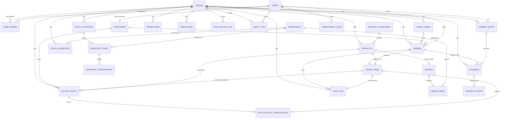

# DATABASE — NightVenue

Pemilik: Backend (Claude + Qwen). Database **PostgreSQL**. Migrasi **Flyway** (`V{n}__{nama}.sql`). `hibernate.ddl-auto` hanya `validate` atau `none`, tidak pernah `update`.

Pendamping: `PRD.md` (BR-xx), `DECISIONS.md` (alasan), `UML.md` (state machine), `APPLICATION_ARCHITECTURE.md`.

---

## 1. Konvensi

| Hal | Aturan |
|---|---|
| Nama | `snake_case`, tabel jamak |
| PK | `BIGINT GENERATED ALWAYS AS IDENTITY` kecuali dinyatakan lain |
| Uang | `BIGINT` rupiah (BR-01) |
| Kuantitas bahan | `NUMERIC(14,3)` |
| Waktu | `TIMESTAMPTZ` (UTC). Hari operasional di kolom `business_date DATE` (ADR-001) |
| Enum | `VARCHAR` + `CHECK (... IN (...))` |
| Audit kolom | `created_at`, `updated_at` pada tabel yang dapat berubah |
| Versi | `version BIGINT NOT NULL DEFAULT 0` hanya pada entitas yang memakai `@Version` |
| Hapus | Tidak ada `DELETE` untuk data master (`is_active`); ledger dan log bersifat append-only |
| Scoping | Tabel transaksional membawa `venue_id` (langsung atau lewat induk) |
| Rahasia | Tidak ada tabel menyimpan API key LLM, nomor identitas, password plain, atau isi chat |

---

## 2. Daftar Tabel

### Month-1 (27 tabel) dengan fase pembuatan

| Fase | Tabel |
|---|---|
| 2 | `venues`, `users`, `user_venues`, `customers`, `product_categories`, `products`, `ingredients`, `recipes`, `recipe_items`, `stock_locations`, `inventory_items`, `inventory_transactions`, `venue_tables`, `audit_logs`, `idempotency_keys` |
| 5 | `orders`, `order_items` |
| 6 | `payments`, `payment_events` |
| 7 | `void_logs`, `bottle_vaults`, `bottle_vault_transactions` |
| 8 | `cashier_shifts` (+ migrasi menambah `payments.shift_id` dan FK-nya) |
| 9 | `stock_forecasts` |
| 10 | `venue_faqs`, `promotions`, `chat_route_logs` |

### Deferred (6 tabel; skema dirancang di bagian 5, **tidak dimigrasi**)
`stock_transfers`, `stock_transfer_items`, `loyalty_accounts`, `loyalty_transactions`, `reservations`, `payment_allocations`.

Tidak di database: refresh token (Redis), isi chat (tidak dipersistensi).

---

## 3. Audit `business_date`

ADR-001 menyatakan kolom ini dipersist hanya pada record yang butuh pengelompokan hari operasional. Keputusan per tabel:

| Tabel | Simpan? | Alasan |
|---|:-:|---|
| `orders` | Ya | Dasar laporan per malam. Diisi saat order dibuka. Dapat berbeda satu hari dari tanggal pembayaran bila tab melewati cutoff |
| `payments` | Ya | Analisis arus kas per malam dan konsistensi dengan shift. Diisi saat payment dibuat |
| `cashier_shifts` | Ya | ADR-002: satu shift = satu business date, diwarisi dari waktu buka |
| `inventory_transactions` | Ya | Forecasting mengagregasi konsumsi per malam; menyimpan menghindari konversi timezone per baris dan menjamin seri waktu yang konsisten dengan laporan |
| `bottle_vault_transactions` | **Tidak** | Tidak ada agregasi per malam di Month-1. Redeem selalu punya `order_item` yang mewarisi `orders.business_date` lewat join. Pengecekan expiry memakai `BusinessDateService` saat request |
| `void_logs` | Tidak | Tidak ada analisis per malam di Month-1 (void anomaly deferred); `orders.business_date` dapat di-join |
| `payment_events` | Tidak | Log teknis webhook |
| `audit_logs` | Tidak | Ditelusuri lewat entitas dan `created_at` |
| `chat_route_logs` | Tidak | Metrik teknis, dianalisis per periode `created_at` |
| `stock_forecasts` | Ya (`as_of_business_date`) | Menandai titik data terakhir yang dipakai model |
| `reservations` (deferred) | — | `reservation_date` sudah merupakan business date menurut definisi |
| `loyalty_transactions` (deferred) | Tidak | Tidak ada pelaporan per malam yang direncanakan |

Index umum: `(venue_id, business_date)` pada `orders` dan `payments`, `(business_date)` pada `inventory_transactions` (venue didapat lewat `inventory_item → stock_location`).

---

## 4. Definisi Tabel (Month-1)

Legenda: **PK**, **FK**, **UQ**, **NN** (not null), **CK** (check).

### 4.1 Venue dan Akses

**venues**
| Kolom | Tipe | Catatan |
|---|---|---|
| id | BIGINT | PK |
| code | VARCHAR(30) | UQ NN |
| name | VARCHAR(120) | NN (nama fiktif) |
| address | VARCHAR(255) | untuk jawaban chat |
| timezone | VARCHAR(50) | NN default `Asia/Jakarta` |
| business_day_cutoff_hour | SMALLINT | NN default 6, CK 0–23 (ADR-001) |
| tax_rate_bps | INT | NN default 0, CK 0–10000 |
| service_charge_bps | INT | NN default 0, CK 0–10000 |
| void_manager_approval_threshold | BIGINT | NN default 500000 (contoh demo), CK ≥ 0 (BR-16) |
| opening_hours | JSONB | untuk chat |
| is_active | BOOLEAN | NN default true |
| created_at, updated_at | TIMESTAMPTZ | NN |

**users**: `id` PK; `email` VARCHAR(255) UQ NN (lowercase); `password_hash` VARCHAR(100) NN (BCrypt); `full_name` VARCHAR(120) NN; `role` VARCHAR(20) NN CK `ADMIN, MANAGER, CASHIER, CUSTOMER`; `is_active` BOOLEAN NN default true; `last_login_at`; `version` BIGINT NN; `created_at`, `updated_at`.

**user_venues**: `user_id` FK→users PK(1); `venue_id` FK→venues PK(2).

**customers**: `id` PK; `user_id` FK→users UQ **nullable**; `full_name` NN; `phone` VARCHAR(30) UQ nullable; `email` VARCHAR(255); `age_verified` BOOLEAN NN default false; `age_verified_at`; `age_verified_by` FK→users; `created_at`, `updated_at`.
CK: `age_verified = false OR (age_verified_at IS NOT NULL AND age_verified_by IS NOT NULL)`. Tidak ada kolom tanggal lahir atau nomor identitas.

### 4.2 Katalog

**product_categories**: `id` PK, `name` VARCHAR(100) UQ NN, `sort_order` INT NN default 0, `is_active` BOOLEAN NN default true (Phase 4A soft delete). `name` remains globally unique, so inactive names stay reserved.

**products**: `id` PK; `venue_id` FK NN; `category_id` FK; `sku` VARCHAR(40) NN, UQ `(venue_id, sku)`; `name` VARCHAR(150) NN; `price` BIGINT NN CK ≥ 0; `is_bottle_keepable` BOOLEAN NN default false; `bottle_volume_ml` INT CK > 0 (wajib bila `is_bottle_keepable`); `is_active` BOOLEAN NN; `version` BIGINT NN; `created_at`, `updated_at`.

**ingredients**: `id` PK; `sku` VARCHAR(40) UQ NN; `name` VARCHAR(120) NN; `unit` VARCHAR(10) NN CK `ML, GRAM, PIECE`; `is_active` NN.

**recipes**: `id` PK; `product_id` FK→products UQ NN; `version` BIGINT; `updated_at`. Produk kemasan utuh memakai recipe satu item `PIECE`.

**recipe_items**: `id` PK; `recipe_id` FK NN; `ingredient_id` FK NN; `quantity` NUMERIC(14,3) NN CK > 0; UQ `(recipe_id, ingredient_id)`.

> Recipe versioning deferred. Karena itu pengembalian stok pada VOID **dibaca dari ledger**, bukan dihitung ulang dari recipe (ADR-004).

### 4.3 Inventory

**stock_locations**: `id` PK; `venue_id` FK NN; `name` VARCHAR(100) NN; `type` NN CK `WAREHOUSE, BAR`; UQ `(venue_id, name)`. Penjualan memotong tepat satu `BAR` per venue (BR-26); partial UQ `(venue_id) WHERE type = 'BAR'`.

**inventory_items**: `id` PK; `location_id` FK NN; `ingredient_id` FK NN; `quantity` NUMERIC(14,3) NN **CK ≥ 0**; `reorder_level` NUMERIC(14,3) NN default 0; `version` BIGINT NN (jalur admin; jalur POS memakai conditional UPDATE); `updated_at`. UQ `(location_id, ingredient_id)`.

**inventory_transactions** (ledger, append-only)
| Kolom | Tipe | Catatan |
|---|---|---|
| id | BIGINT | PK |
| inventory_item_id | BIGINT | FK NN |
| type | VARCHAR(20) | NN CK `PURCHASE_IN, SALE_DEDUCT, VOID_RETURN, WASTE, ADJUSTMENT` |
| delta | NUMERIC(14,3) | NN (negatif = keluar) |
| balance_after | NUMERIC(14,3) | NN CK ≥ 0 |
| business_date | DATE | NN (ADR-001) |
| reference_type | VARCHAR(20) | CK `ORDER_ITEM, VOID_LOG, MANUAL, SEED` |
| reference_id | BIGINT | |
| reason | VARCHAR(255) | wajib untuk `WASTE`, `ADJUSTMENT` (`ck_inventory_transaction_reason`) |
| created_by | BIGINT | FK→users nullable (null untuk `SEED`) |
| created_at | TIMESTAMPTZ | NN |

`VOID_RETURN` membalik persis baris `SALE_DEDUCT` item terkait (delta berlawanan, `reference_type = VOID_LOG`).

### 4.4 POS

**venue_tables**: `id` PK; `venue_id` FK NN; `code` VARCHAR(20) NN, UQ `(venue_id, code)`; `area` VARCHAR(50); `capacity` INT NN CK > 0; `minimum_spend` BIGINT NN default 0 CK ≥ 0; `status` VARCHAR(20) NN CK `AVAILABLE, OCCUPIED, OUT_OF_SERVICE`; `is_active` NN; `version` NN. (`RESERVED` ditambahkan oleh migrasi reservasi yang deferred.)

**orders**
| Kolom | Tipe | Catatan |
|---|---|---|
| id | BIGINT | PK |
| venue_id | BIGINT | FK NN |
| order_number | VARCHAR(30) | NN, UQ `(venue_id, order_number)` |
| table_id | BIGINT | FK→venue_tables nullable |
| customer_id | BIGINT | FK→customers nullable |
| cashier_id | BIGINT | FK→users NN |
| business_date | DATE | NN (saat dibuka) |
| status | VARCHAR(15) | NN CK `OPEN, PARTIALLY_PAID, PAID, VOIDED, REFUNDED` (`REFUNDED` dicadangkan) |
| subtotal | BIGINT | NN ≥ 0 (item non-void) |
| discount_amount | BIGINT | NN default 0 |
| service_charge_amount | BIGINT | NN default 0 |
| tax_amount | BIGINT | NN default 0 |
| total_due | BIGINT | NN ≥ 0 |
| paid_total | BIGINT | NN default 0 |
| minimum_spend_snapshot | BIGINT | NN default 0 (BR-05) |
| opened_at | TIMESTAMPTZ | NN |
| closed_at | TIMESTAMPTZ | |
| version | BIGINT | NN |

`orders.reservation_id` **tidak ada** di Month-1; ditambahkan oleh migrasi reservasi.

**order_items**
| Kolom | Tipe | Catatan |
|---|---|---|
| id | BIGINT | PK |
| order_id | BIGINT | FK NN |
| product_id | BIGINT | FK NN |
| item_type | VARCHAR(20) | NN CK `PRODUCT, BOTTLE_REDEMPTION` |
| product_name_snapshot | VARCHAR(150) | NN |
| unit_price_snapshot | BIGINT | NN ≥ 0 (boleh 0 untuk `BOTTLE_REDEMPTION`) |
| quantity | INT | NN CK > 0 |
| line_total | BIGINT | NN ≥ 0 |
| status | VARCHAR(10) | NN CK `ORDERED, SERVED, VOIDED` |
| created_at | TIMESTAMPTZ | NN |

Detail void (alasan, pelaku, disposition) ada di `void_logs`, tidak diduplikasi di sini.

### 4.5 Pembayaran

**payments**
| Kolom | Tipe | Catatan |
|---|---|---|
| id | BIGINT | PK |
| order_id | BIGINT | FK NN (Order → Payment = 1:N, ADR-005) |
| venue_id | BIGINT | FK NN (disalin dari order; untuk index per venue-malam) |
| business_date | DATE | NN (saat payment dibuat) |
| shift_id | BIGINT | FK→cashier_shifts nullable (ditambahkan Fase 8). Wajib terisi untuk `method = CASH` (divalidasi aplikasi; semua role) |
| method | VARCHAR(20) | NN CK `CASH, CARD_EDC, QRIS_MIDTRANS` |
| amount | BIGINT | NN CK > 0; ≤ `total_due − SUM(PAID) − SUM(PENDING)`, divalidasi di bawah lock baris order (ADR-005, BR-28) |
| status | VARCHAR(12) | NN CK `PENDING, PAID, FAILED, EXPIRED, CANCELLED, REFUNDED` (`REFUNDED` dicadangkan) |
| provider | VARCHAR(20) | `MIDTRANS` atau null |
| provider_order_id | VARCHAR(60) | UQ nullable |
| provider_transaction_id | VARCHAR(80) | |
| reference_note | VARCHAR(100) | nomor struk EDC dll. |
| paid_at | TIMESTAMPTZ | |
| created_by | BIGINT | FK→users NN |
| created_at, updated_at | TIMESTAMPTZ | NN |
| version | BIGINT | NN |

**payment_events** (log webhook, append-only)
| Kolom | Tipe | Catatan |
|---|---|---|
| id | BIGINT | PK |
| payment_id | BIGINT | FK nullable (event untuk order tak dikenal tetap tercatat) |
| provider | VARCHAR(20) | NN |
| event_key | VARCHAR(160) | NN, **UQ `(provider, event_key)`**; `transaction_id:transaction_status:status_code` |
| signature_valid | BOOLEAN | NN |
| result | VARCHAR(15) | NN CK `PROCESSED, IGNORED_STALE, REJECTED` (`REJECTED` = signature valid tetapi gagal verifikasi Status API / nominal tidak cocok) |
| raw_payload | JSONB | NN (tanpa secret) |
| received_at | TIMESTAMPTZ | NN |

Catatan: `payment_events` adalah **satu record kanonik per `event_key`** (hasil dedup), bukan log setiap pengiriman jaringan. Pengiriman duplikat memakai `INSERT ... ON CONFLICT DO NOTHING`; 0 baris = no-op yang dicatat di log terstruktur (tanpa baris kedua dan tanpa tabel receipt di Month-1). Signature tidak valid tidak membuat baris; cukup `audit_logs` `WEBHOOK_REJECTED`.

### 4.6 VOID

**void_logs** (append-only)
| Kolom | Tipe | Catatan |
|---|---|---|
| id | BIGINT | PK |
| venue_id | BIGINT | FK NN |
| order_id | BIGINT | FK NN |
| order_item_id | BIGINT | FK NN, **UQ** (satu item hanya dapat di-void sekali; penjamin exactly-once) |
| batch_id | UUID | NN (mengelompokkan item dari satu aksi VOID order) |
| voided_by | BIGINT | FK→users NN |
| approved_by | BIGINT | FK→users nullable (diisi bila di atas ambang dan Manager mengeksekusi) |
| reason | VARCHAR(255) | NN |
| disposition | VARCHAR(10) | NN CK `RESTORED, WASTED` |
| item_value | BIGINT | NN ≥ 0 (`line_total` saat void) |
| created_at | TIMESTAMPTZ | NN |

### 4.7 Bottle Keeping

**bottle_vaults**
| Kolom | Tipe | Catatan |
|---|---|---|
| id | BIGINT | PK |
| venue_id | BIGINT | FK NN |
| customer_id | BIGINT | FK NN |
| product_id | BIGINT | FK NN (harus `is_bottle_keepable`) |
| source_order_item_id | BIGINT | FK→order_items, **UQ**, nullable (satu order item menghasilkan paling banyak satu vault: deposit exactly-once) |
| label_code | VARCHAR(20) | NN UQ (tercetak di label, bukan rahasia) |
| qr_token_hash | CHAR(64) | NN UQ (SHA-256 token QR; token mentah tidak disimpan, ADR-020) |
| original_volume_ml | INT | NN CK > 0 |
| remaining_volume_ml | INT | NN |
| stored_at | TIMESTAMPTZ | NN |
| expiry_date | DATE | NN |
| status | VARCHAR(10) | NN CK `ACTIVE, EMPTY, EXPIRED, RELEASED` |
| version | BIGINT | NN |
| created_at, updated_at | TIMESTAMPTZ | NN |

CK: `remaining_volume_ml >= 0 AND remaining_volume_ml <= original_volume_ml` (BR-09).

**Aturan deposit Month-1 (exactly-once, BR-29):** satu botol fisik = satu `order_item` dengan `quantity = 1`. Produk `is_bottle_keepable` dengan `quantity > 1` ditolak 422 saat ditambahkan ke order (dua botol = dua order item). `source_order_item_id` UNIQUE. Deposit memakai `Idempotency-Key` (scope `BOTTLE_DEPOSIT`); request kedua untuk item yang sama dengan key berbeda → 409 `VAULT_ALREADY_EXISTS`.

**bottle_vault_transactions** (append-only)
| Kolom | Tipe | Catatan |
|---|---|---|
| id | BIGINT | PK |
| vault_id | BIGINT | FK NN |
| type | VARCHAR(10) | NN CK `DEPOSIT, REDEEM, RELEASE, EXPIRE, ADJUST` |
| volume_delta_ml | INT | NN |
| remaining_after_ml | INT | NN CK ≥ 0 |
| order_item_id | BIGINT | FK nullable (untuk `REDEEM`) |
| owner_confirmed | BOOLEAN | NN default false (BR-25; wajib true untuk `REDEEM`) |
| performed_by | BIGINT | FK→users NN |
| note | VARCHAR(255) | |
| created_at | TIMESTAMPTZ | NN |

### 4.8 Shift

**cashier_shifts**
| Kolom | Tipe | Catatan |
|---|---|---|
| id | BIGINT | PK |
| venue_id | BIGINT | FK NN |
| cashier_id | BIGINT | FK→users NN |
| business_date | DATE | NN (diwarisi dari `opened_at`, ADR-002) |
| status | VARCHAR(15) | NN CK `OPEN, SUBMITTED, MANAGER_REVIEW, RECONCILED` |
| opening_float | BIGINT | NN CK ≥ 0 |
| opened_at | TIMESTAMPTZ | NN |
| submitted_at | TIMESTAMPTZ | |
| forced_review_at | TIMESTAMPTZ | diisi saat cutoff memaksa `MANAGER_REVIEW` |
| expected_cash | BIGINT | snapshot saat submit / review |
| actual_cash | BIGINT | CK ≥ 0 |
| variance | BIGINT | `actual_cash − expected_cash` |
| reviewed_by | BIGINT | FK→users |
| reviewed_at | TIMESTAMPTZ | |
| review_note | VARCHAR(500) | wajib bila variance ≠ 0 atau `forced_review_at` terisi (validasi aplikasi) |
| version | BIGINT | NN |

CK: `status <> 'RECONCILED' OR (reviewed_by IS NOT NULL AND reviewed_at IS NOT NULL AND actual_cash IS NOT NULL)`.
Partial UQ: `UNIQUE (cashier_id) WHERE status = 'OPEN'`.

### 4.9 ML dan Chat

**stock_forecasts**: `id` PK; `venue_id` FK NN; `ingredient_id` FK NN; `generated_at` NN; `as_of_business_date` DATE NN; `horizon_days` INT NN; `predicted_quantity` NUMERIC(14,3) NN; `model_name` VARCHAR(40) NN; `model_mae` NUMERIC(14,3); `baseline_mae` NUMERIC(14,3); `input_days` INT NN; `requested_by` FK→users NN.

**venue_faqs** (basis pengetahuan lokal chat): `id` PK; `venue_id` FK NN; `intent` VARCHAR(40) NN (salah satu dari 11 intent, ADR-011); `answer_template` TEXT NN; `is_active` BOOLEAN NN; UQ `(venue_id, intent)`.

**promotions**: `id` PK; `venue_id` FK NN; `title` NN; `description` TEXT; `starts_on` DATE NN; `ends_on` DATE NN CK `>= starts_on`; `is_active` BOOLEAN NN. Rentang tanggal dibaca sebagai business date.

**chat_route_logs** (metrik untuk Bukti D; **tanpa isi pesan, tanpa key**)
| Kolom | Tipe | Catatan |
|---|---|---|
| id | BIGINT | PK |
| venue_id | BIGINT | FK nullable |
| route | VARCHAR(25) | NN CK `LOCAL, FALLBACK, LLM, REFUSED, ADVANCED_AI_REQUIRED` |
| intent | VARCHAR(40) | null bila classifier tidak tersedia |
| confidence | NUMERIC(5,4) | |
| ml_available | BOOLEAN | NN |
| classifier_ms | INT | |
| llm_provider | VARCHAR(10) | CK `GEMINI, GROQ` nullable |
| llm_ms | INT | |
| input_tokens | INT | dari respons provider |
| output_tokens | INT | |
| estimated_cost_usd | NUMERIC(12,6) | dari token × harga konfigurasi; bisa 0 pada free tier (catat basis harga) |
| created_at | TIMESTAMPTZ | NN |

### 4.10 Sistem

**audit_logs** (append-only): `id` PK; `venue_id` FK nullable; `actor_user_id` FK nullable; `action` VARCHAR(50) NN (mis. `ORDER_VOID`, `STOCK_ADJUST`, `SHIFT_FORCED_REVIEW`, `PAYMENT_ON_CLOSED_ORDER`, `WEBHOOK_REJECTED`); `entity_type` VARCHAR(50) NN; `entity_id` BIGINT; `details` JSONB; `ip_address` VARCHAR(45); `created_at` NN.

**idempotency_keys**: `id` PK; `key` UUID NN; `scope` VARCHAR(40) NN CK `ORDER_ADD_ITEMS, PAYMENT_CREATE, ORDER_VOID, BOTTLE_DEPOSIT, BOTTLE_REDEEM`; `user_id` FK NN; `request_hash` CHAR(64) NN; `response_status` INT; `response_body` JSONB; `created_at` NN. UQ `(scope, user_id, key)`. Dibersihkan berkala (> 24 jam). Scope baru butuh migrasi.

---

## 5. Deferred (skema rancangan; tidak dimigrasi di Month-1)

| Tabel | Ringkasan | Prasyarat |
|---|---|---|
| `reservations` | meja, customer, `reservation_date`, `arrival_time`, `party_size`, status `PENDING/CONFIRMED/CHECKED_IN/COMPLETED/CANCELLED/NO_SHOW`; partial UQ `(table_id, reservation_date)` untuk status aktif; menambah `orders.reservation_id` dan status meja `RESERVED` | Keputusan PM |
| `loyalty_accounts`, `loyalty_transactions` | ledger poin; partial UQ `(order_id, type) WHERE type IN ('EARN','REVERSAL')` | Keputusan PM (OD-7) |
| `stock_transfers`, `stock_transfer_items` | `REQUESTED → APPROVED → COMPLETED / REJECTED`; menambah tipe ledger `TRANSFER_OUT/IN` | Keputusan PM |
| `payment_allocations` | `payment_id`, `order_item_id`, `amount`; UQ `(payment_id, order_item_id)` | Split-bill per item |

---

## 6. Constraint Kritis (DDL acuan)

```sql
-- Stok tidak boleh negatif (BR-03)
ALTER TABLE inventory_items ADD CONSTRAINT ck_inventory_qty_nonneg CHECK (quantity >= 0);

-- Satu lokasi BAR per venue (BR-26)
CREATE UNIQUE INDEX uq_one_bar_per_venue ON stock_locations (venue_id) WHERE type = 'BAR';

-- Satu order aktif per meja (BR-06)
CREATE UNIQUE INDEX uq_orders_active_table ON orders (table_id)
  WHERE table_id IS NOT NULL AND status IN ('OPEN', 'PARTIALLY_PAID');

-- Item hanya dapat di-void sekali (BR-19, exactly-once)
ALTER TABLE void_logs ADD CONSTRAINT uq_void_once_per_item UNIQUE (order_item_id);

-- Webhook idempotent (BR-13)
ALTER TABLE payment_events ADD CONSTRAINT uq_payment_events_key UNIQUE (provider, event_key);

-- Invarian volume botol (BR-09)
ALTER TABLE bottle_vaults ADD CONSTRAINT ck_vault_volume
  CHECK (remaining_volume_ml >= 0 AND remaining_volume_ml <= original_volume_ml);

-- Satu order item hanya dapat menjadi sumber satu vault (BR-29)
ALTER TABLE bottle_vaults ADD CONSTRAINT uq_vault_source_item UNIQUE (source_order_item_id);

-- Satu shift OPEN per cashier (BR-22)
CREATE UNIQUE INDEX uq_one_open_shift_per_cashier ON cashier_shifts (cashier_id) WHERE status = 'OPEN';

-- Idempotency-Key
ALTER TABLE idempotency_keys ADD CONSTRAINT uq_idem UNIQUE (scope, user_id, key);
```

### Index tambahan (awal; sempurnakan dengan `EXPLAIN` di Phase 11)

| Tabel | Index | Untuk |
|---|---|---|
| orders | `(venue_id, business_date, status)` | Laporan per malam |
| order_items | `(order_id)` | Muat item |
| inventory_transactions | `(inventory_item_id, created_at)`, `(business_date)` | Riwayat; agregasi forecast; pembalikan void |
| payments | `(order_id)`, `(venue_id, business_date)`, `(shift_id)`, `(provider_order_id)` | Total bayar; agregasi kas shift; lookup webhook |
| bottle_vaults | `(customer_id, status)`, `(expiry_date) WHERE status = 'ACTIVE'` | Daftar botol; job expiry |
| cashier_shifts | `(venue_id, business_date, status)` | Antrian review manager |
| void_logs | `(order_id)` | Telusur void per order |
| chat_route_logs | `(created_at)`, `(route)` | Analisis biaya |
| audit_logs | `(entity_type, entity_id)`, `(created_at)` | Penelusuran |

---

## 7. Relational Table (Matriks Foreign Key, Month-1)

`RESTRICT` = tidak boleh dihapus selagi ada anak (default data bisnis).

| # | Tabel anak . kolom | Tabel induk . kolom | Kardinalitas | ON DELETE | Catatan |
|---|---|---|---|---|---|
| 1 | user_venues.user_id | users.id | N:1 | CASCADE | |
| 2 | user_venues.venue_id | venues.id | N:1 | CASCADE | |
| 3 | customers.user_id | users.id | 1:0..1 | SET NULL | Customer tanpa akun |
| 4 | customers.age_verified_by | users.id | N:1 | RESTRICT | |
| 5 | products.venue_id | venues.id | N:1 | RESTRICT | |
| 6 | products.category_id | product_categories.id | N:1 | RESTRICT | |
| 7 | recipes.product_id | products.id | 1:0..1 | CASCADE | |
| 8 | recipe_items.recipe_id | recipes.id | N:1 | CASCADE | |
| 9 | recipe_items.ingredient_id | ingredients.id | N:1 | RESTRICT | |
| 10 | stock_locations.venue_id | venues.id | N:1 | RESTRICT | |
| 11 | inventory_items.location_id | stock_locations.id | N:1 | RESTRICT | |
| 12 | inventory_items.ingredient_id | ingredients.id | N:1 | RESTRICT | |
| 13 | inventory_transactions.inventory_item_id | inventory_items.id | N:1 | RESTRICT | Ledger permanen |
| 14 | inventory_transactions.created_by | users.id | N:0..1 | RESTRICT | null untuk SEED |
| 15 | venue_tables.venue_id | venues.id | N:1 | RESTRICT | |
| 16 | orders.venue_id | venues.id | N:1 | RESTRICT | |
| 17 | orders.table_id | venue_tables.id | N:0..1 | RESTRICT | |
| 18 | orders.customer_id | customers.id | N:0..1 | RESTRICT | |
| 19 | orders.cashier_id | users.id | N:1 | RESTRICT | |
| 20 | order_items.order_id | orders.id | N:1 | RESTRICT | |
| 21 | order_items.product_id | products.id | N:1 | RESTRICT | |
| 22 | payments.order_id | orders.id | N:1 | RESTRICT | Order 1:N Payment |
| 23 | payments.venue_id | venues.id | N:1 | RESTRICT | |
| 24 | payments.shift_id | cashier_shifts.id | N:0..1 | RESTRICT | Ditambahkan Fase 8 |
| 25 | payments.created_by | users.id | N:1 | RESTRICT | |
| 26 | payment_events.payment_id | payments.id | N:0..1 | SET NULL | Event tetap tercatat |
| 27 | void_logs.venue_id | venues.id | N:1 | RESTRICT | |
| 28 | void_logs.order_id | orders.id | N:1 | RESTRICT | |
| 29 | void_logs.order_item_id | order_items.id | 1:1 | RESTRICT | UQ |
| 30 | void_logs.voided_by | users.id | N:1 | RESTRICT | |
| 31 | void_logs.approved_by | users.id | N:0..1 | RESTRICT | |
| 32 | cashier_shifts.venue_id | venues.id | N:1 | RESTRICT | |
| 33 | cashier_shifts.cashier_id | users.id | N:1 | RESTRICT | |
| 34 | cashier_shifts.reviewed_by | users.id | N:0..1 | RESTRICT | |
| 35 | bottle_vaults.venue_id | venues.id | N:1 | RESTRICT | |
| 36 | bottle_vaults.customer_id | customers.id | N:1 | RESTRICT | |
| 37 | bottle_vaults.product_id | products.id | N:1 | RESTRICT | |
| 38 | bottle_vaults.source_order_item_id | order_items.id | 1:0..1 | SET NULL | UQ (deposit exactly-once) |
| 39 | bottle_vault_transactions.vault_id | bottle_vaults.id | N:1 | RESTRICT | |
| 40 | bottle_vault_transactions.order_item_id | order_items.id | N:0..1 | SET NULL | |
| 41 | bottle_vault_transactions.performed_by | users.id | N:1 | RESTRICT | |
| 42 | stock_forecasts.venue_id | venues.id | N:1 | RESTRICT | |
| 43 | stock_forecasts.ingredient_id | ingredients.id | N:1 | RESTRICT | |
| 44 | stock_forecasts.requested_by | users.id | N:1 | RESTRICT | |
| 45 | venue_faqs.venue_id | venues.id | N:1 | CASCADE | |
| 46 | promotions.venue_id | venues.id | N:1 | CASCADE | |
| 47 | chat_route_logs.venue_id | venues.id | N:0..1 | SET NULL | |
| 48 | audit_logs.venue_id | venues.id | N:0..1 | SET NULL | |
| 49 | audit_logs.actor_user_id | users.id | N:0..1 | SET NULL | |
| 50 | idempotency_keys.user_id | users.id | N:1 | CASCADE | |

**Deferred** (tidak dimigrasi): `stock_transfers.from_location_id / to_location_id → stock_locations`, `stock_transfers.requested_by / approved_by → users`, `stock_transfer_items.transfer_id → stock_transfers`, `stock_transfer_items.ingredient_id → ingredients`, `loyalty_accounts.customer_id → customers` (1:1), `loyalty_transactions.account_id → loyalty_accounts`, `loyalty_transactions.order_id → orders`, `reservations.venue_id / table_id / customer_id`, `orders.reservation_id → reservations`, `payment_allocations.payment_id → payments`, `payment_allocations.order_item_id → order_items`.

---

## 8. ERD (Month-1)



---

## 9. Seed dan Data Sintetis

Seeder idempotent (upsert berdasar `code`/`sku`/`email`).

| Data | Isi |
|---|---|
| Venue | 2 venue fiktif (nama bukan merek nyata) |
| Akun demo | `admin@`, `manager@`, `cashier@`, `customer@` (password demo di README, hanya untuk lingkungan demo) |
| Meja | 10–15 per venue; area berbeda (mis. Main Floor, VIP, Bar Side) dengan minimum spend berbeda |
| Bahan dan recipe | ± 25 bahan, ± 20 produk (koktail, botol, makanan ringan) |
| Stok awal | Lokasi `WAREHOUSE` dan `BAR` terisi |
| Customer demo | beberapa customer, sebagian `age_verified`, satu botol titipan contoh |
| Basis pengetahuan chat | `venue_faqs` untuk tiap intent lokal + `promotions` (Fase 10) |
| Dataset ML | Terpisah di `ml-service/data/` (latih, validasi, uji), bukan di Flyway |

**Riwayat sintetis ≈ 90 hari (untuk forecasting).** Tabel order baru ada di Fase 5, sedangkan seeder berjalan di Fase 2. Karena itu seeder riwayat menulis **ledger konsumsi saja** di `inventory_transactions` (`type = SALE_DEDUCT`, `reference_type = SEED`, `created_by` null) dengan:
- pola hari-dalam-minggu (Jumat/Sabtu tertinggi), jam operasional malam, noise acak dengan **seed tetap** agar hasil dapat diulang;
- `PURCHASE_IN` periodik agar saldo tidak pernah negatif;
- rantai `balance_after` yang konsisten dengan `inventory_items.quantity` akhir (diverifikasi test: saldo akhir = stok awal + Σ delta);
- `business_date` diisi lewat `BusinessDateService`, bukan dihitung terpisah.
Riwayat order/payment sintetis bersifat opsional (Fase 11, hanya bila dibutuhkan demo). Dokumentasi harus menyebut data ini sintetis.

---

## 10. Aturan Migration

1. Satu file per perubahan logis; migration yang sudah di-merge tidak diedit (buat `V{n+1}`).
2. Setiap migration baru diuji dengan menjalankan seluruh rantai dari DB kosong di Testcontainers.
3. Constraint dan index kritis di bagian 6 **wajib** ada di migration, bukan hanya di kode.
4. Tidak ada `DROP` data tanpa persetujuan PM.
5. Migration dipecah per fase sesuai bagian 2; `payments.shift_id` ditambahkan oleh migrasi Fase 8 karena `cashier_shifts` dibuat di sana.
6. Agent yang membuat migration melaporkan nama file di laporan PR. Seeder berjalan dua kali tanpa duplikat.
