# UML — NightVenue

Pendamping: `PRD.md`, `DATABASE.md`, `APPLICATION_ARCHITECTURE.md`, `DECISIONS.md`. Semua diagram Mermaid. Label memakai ` `, bukan `\n`.

---

## 1. Use Case

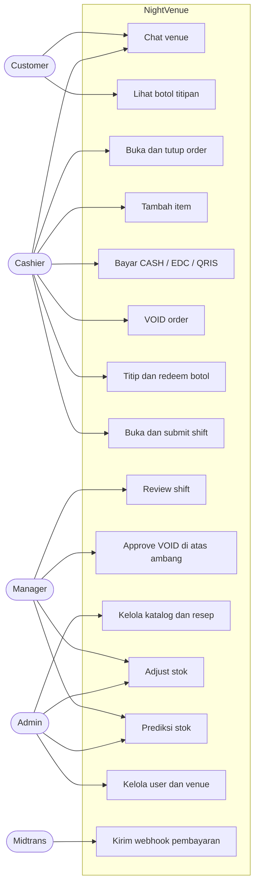

Role tidak hierarkis. Otorisasi mengikuti matriks kapabilitas eksplisit di `PRD.md` bagian 4, tanpa pewarisan hak.

---

## 2. Diagram Kelas Domain

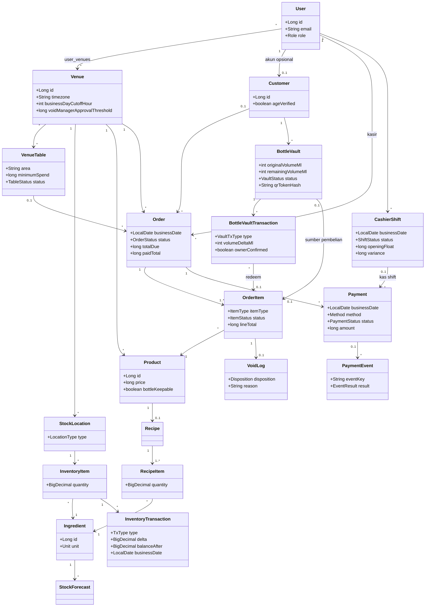

---

## 3. Diagram Kelas Service

```mermaid
classDiagram
    class BusinessDateService {
        +businessDate(Instant, ZoneId, int cutoffHour) LocalDate
        +currentBusinessDate(ZoneId, int cutoffHour) LocalDate
    }
    class OrderService {
        +open(cmd) Order
        +addItems(orderId, items, key) Order
        +serve(orderId, itemId)
    }
    class InventoryService {
        +deductForItem(item, barLocation)
        +adjust(cmd)
    }
    class VoidService {
        +voidOrder(orderId, reason, disposition, key)
    }
    class PaymentService {
        +create(orderId, cmd, key) Payment
        +handleWebhook(payload, signature)
    }
    class PaymentGateway {
        <<interface>>
        +createTransaction(payment)
        +fetchStatus(providerOrderId)
    }
    class MidtransGateway
    class ShiftService {
        +open(cashier, openingFloat) CashierShift
        +submit(shiftId, actualCash)
        +review(shiftId, note)
        +forceReviewAtCutoff()
    }
    class BottleService {
        +deposit(orderItemId, customerId) DepositResult
        +redeem(qrToken, orderId, volumeMl, ownerConfirmed, key)
        +expireJob()
    }
    class ForecastService {
        +forecast(ingredientId) StockForecast
    }
    class ChatRouter {
        +handle(message, aiKey, provider) ChatResponse
    }
    class MlClient {
        +classify(message) ClassifyResult
        +forecast(series) ForecastResult
    }
    class LlmProvider {
        <<interface>>
        +complete(context, message, key) LlmResult
    }
    class GeminiProvider
    class GroqProvider

    OrderService --> BusinessDateService
    OrderService --> InventoryService
    VoidService --> BusinessDateService
    VoidService --> InventoryService
    PaymentService --> BusinessDateService
    PaymentService --> PaymentGateway
    PaymentService --> ShiftService : validasi shift OPEN
    MidtransGateway ..|> PaymentGateway
    ShiftService --> BusinessDateService
    BottleService --> BusinessDateService
    ForecastService --> MlClient
    ChatRouter --> MlClient
    ChatRouter --> LlmProvider
    GeminiProvider ..|> LlmProvider
    GroqProvider ..|> LlmProvider
```

---

## 4. Sequence

### 4.1 Buat order dan tambah item (Stock-at-Order)

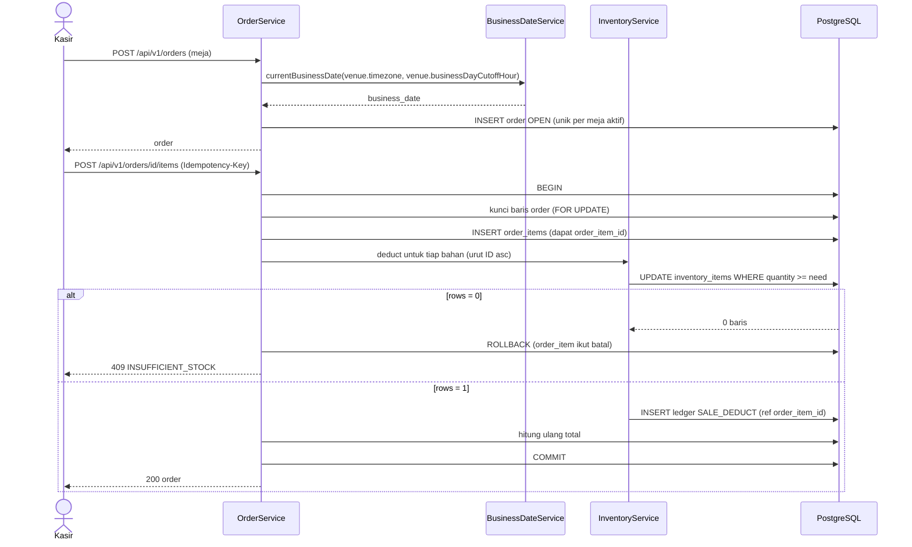

### 4.2 Pembayaran tunai dengan pengecekan shift

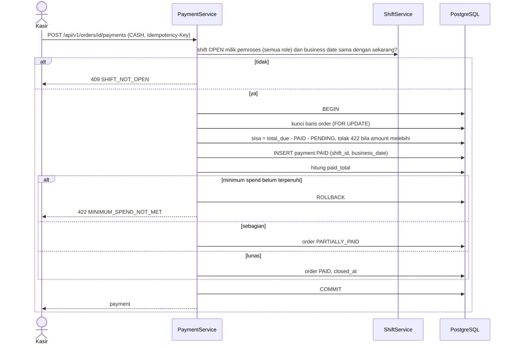

### 4.3 QRIS dan webhook duplikat

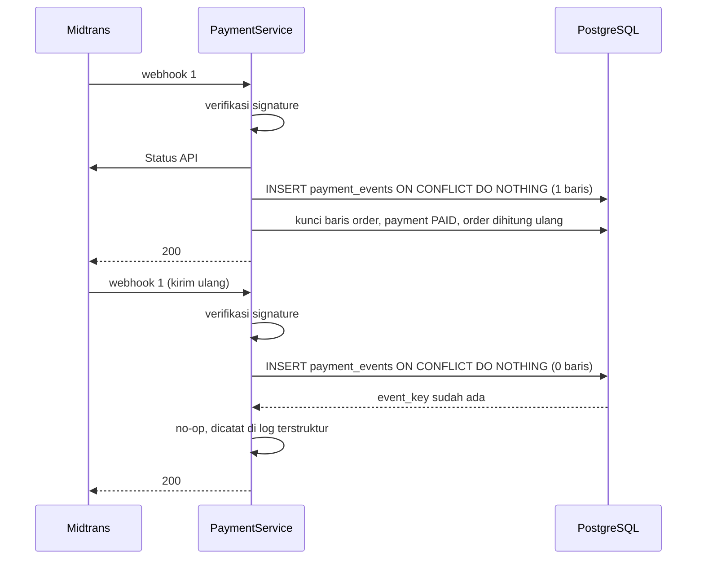

### 4.4 VOID order

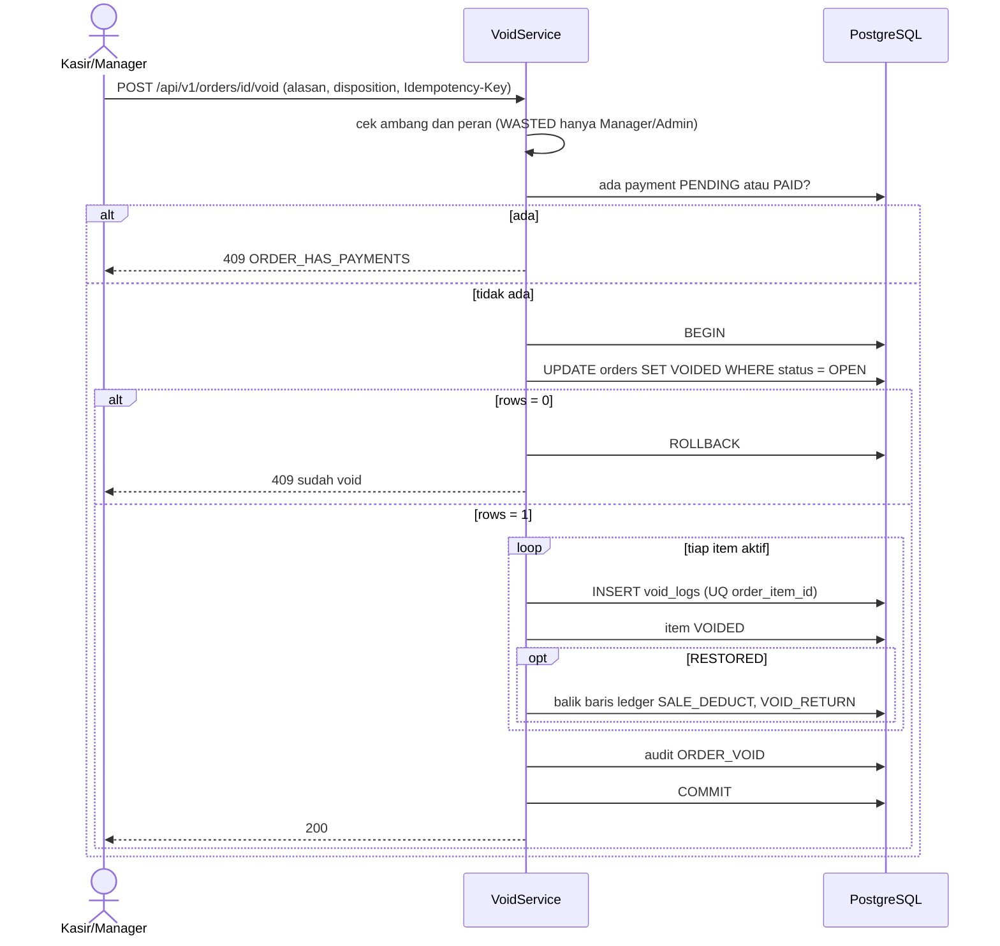

### 4.5 Deposit botol

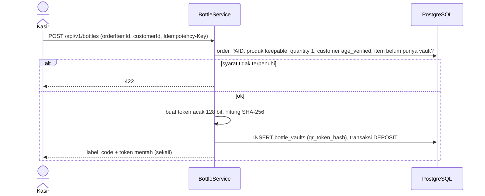

### 4.6 Redeem botol

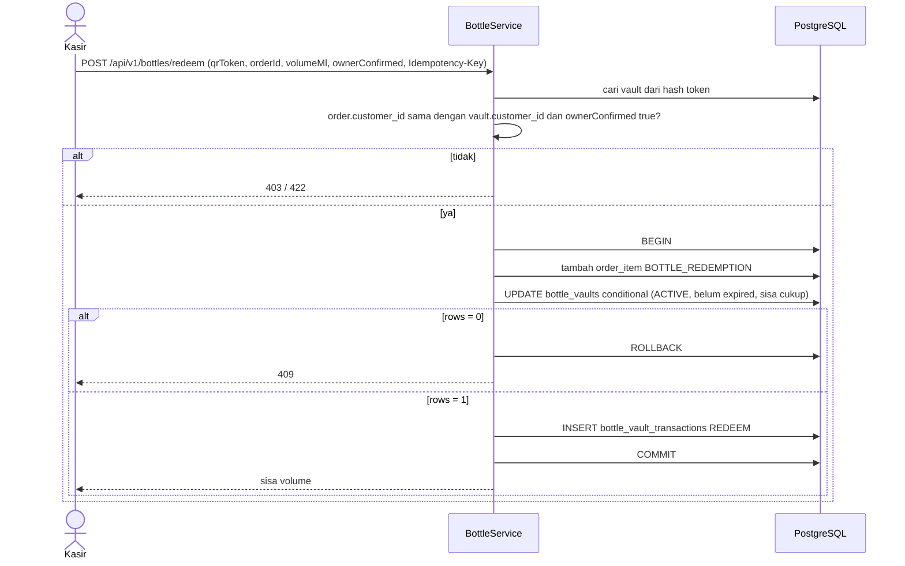

### 4.7 Shift: buka, submit, review, cutoff

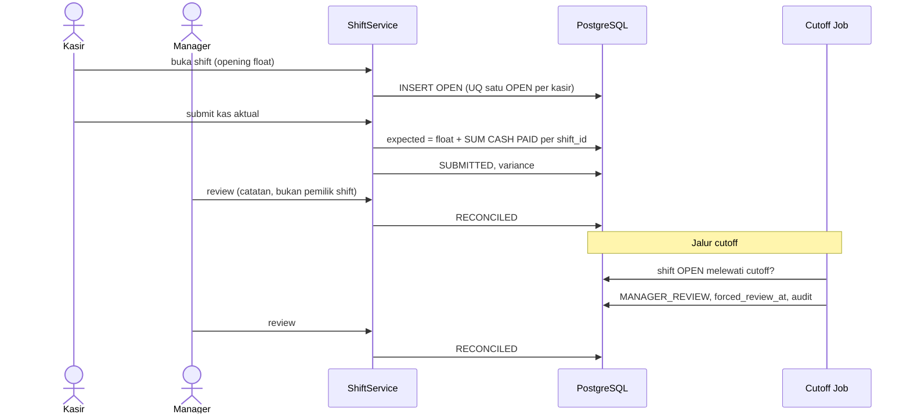

### 4.8 Chat lokal, fallback, eskalasi LLM

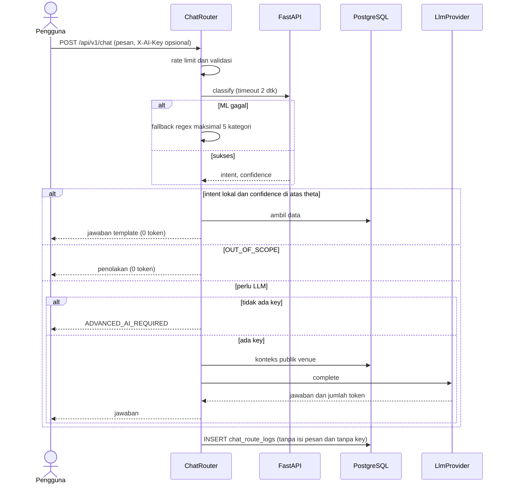

### 4.9 Forecasting

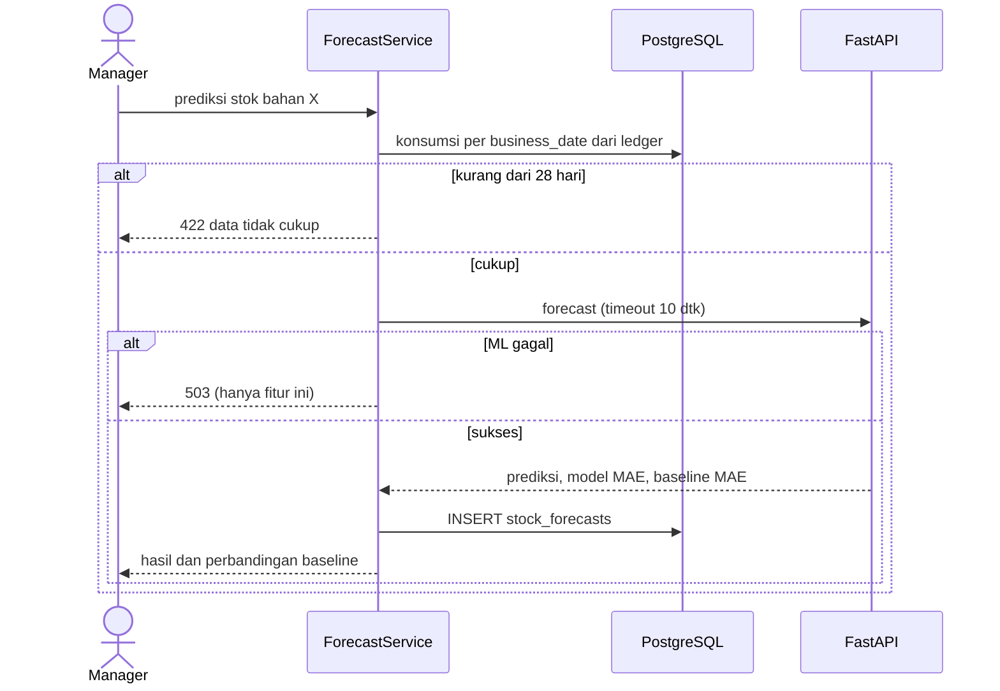

---

## 5. State Machine

### 5.1 Order

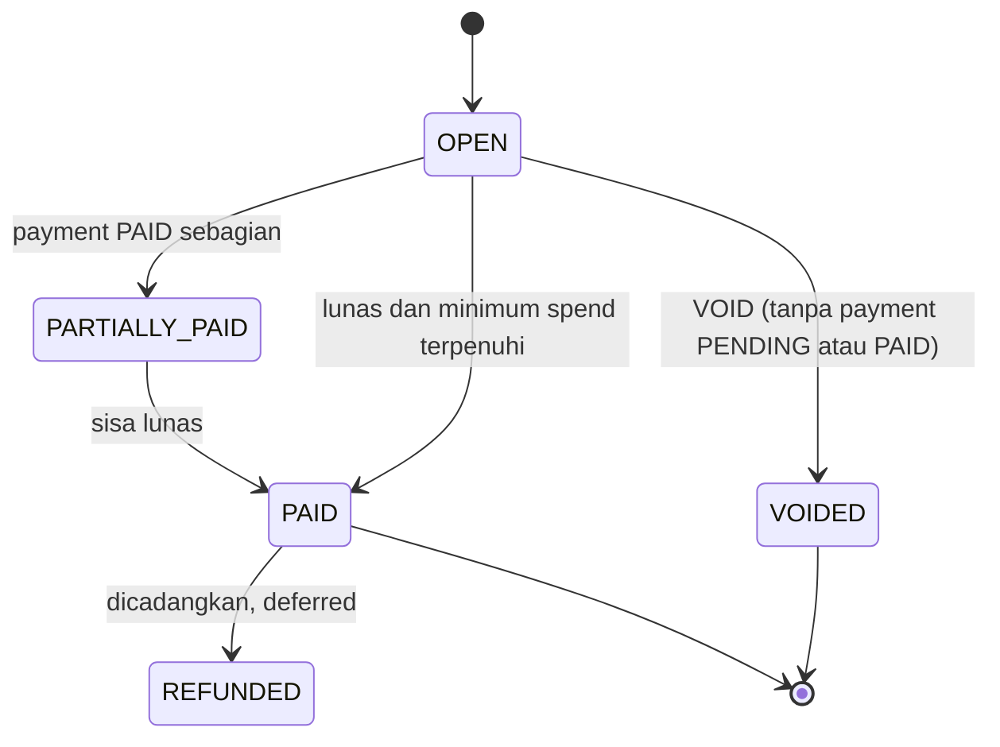

### 5.2 Order item

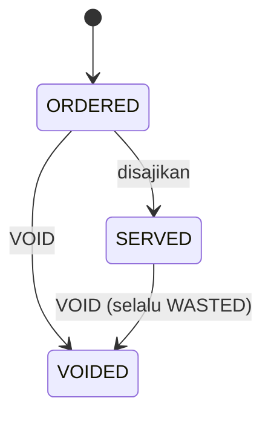

### 5.3 Payment

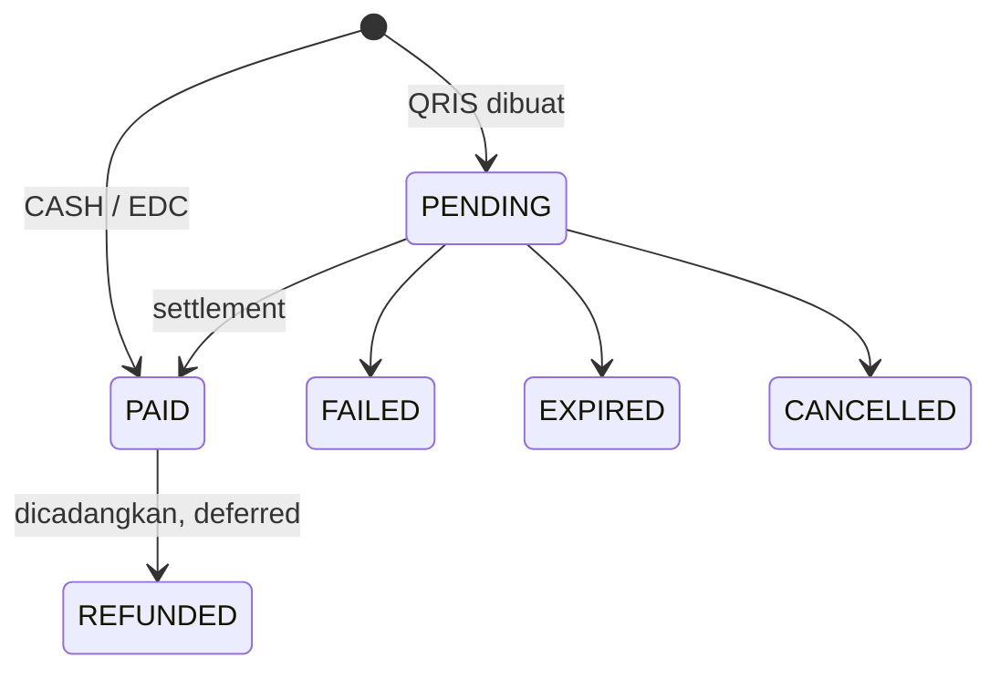

Transisi mundur dari status terminal ditolak (`IGNORED_STALE`).

### 5.4 Bottle vault

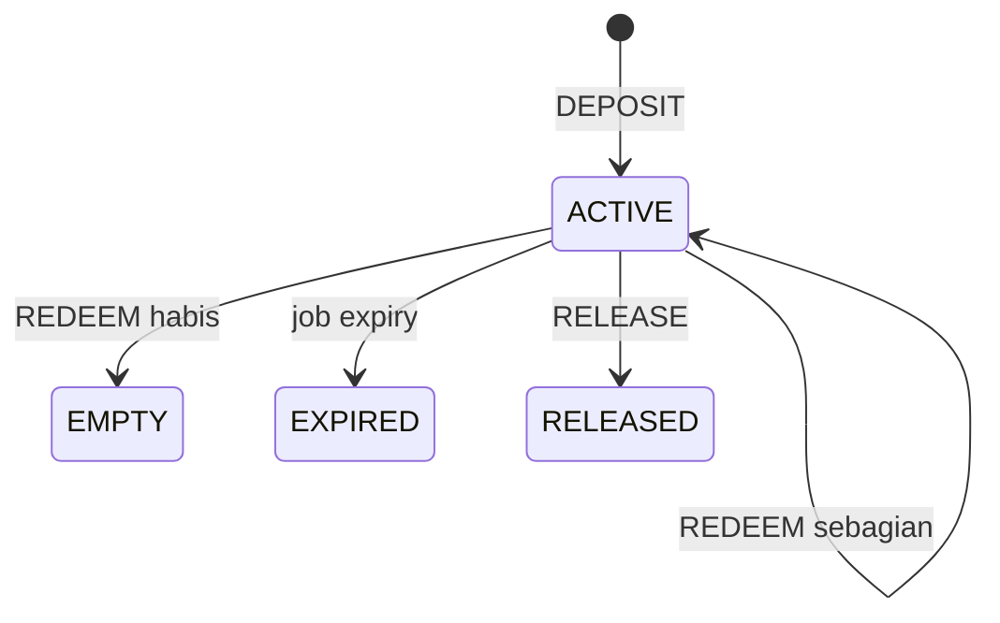

### 5.5 Shift

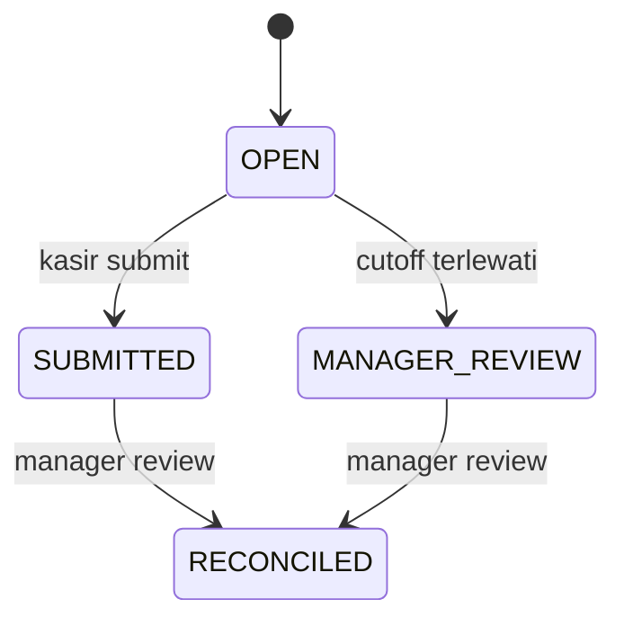

---

## 6. Activity: Checkout

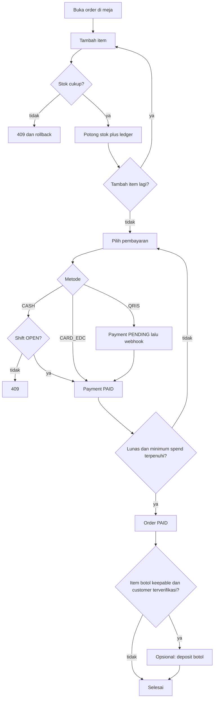
